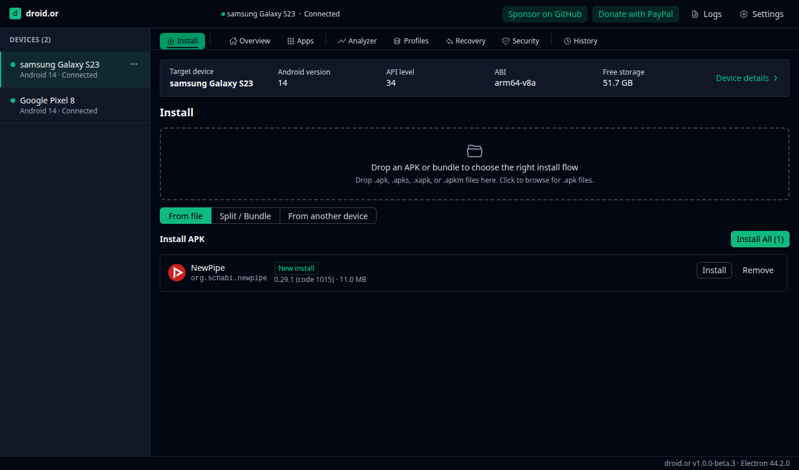
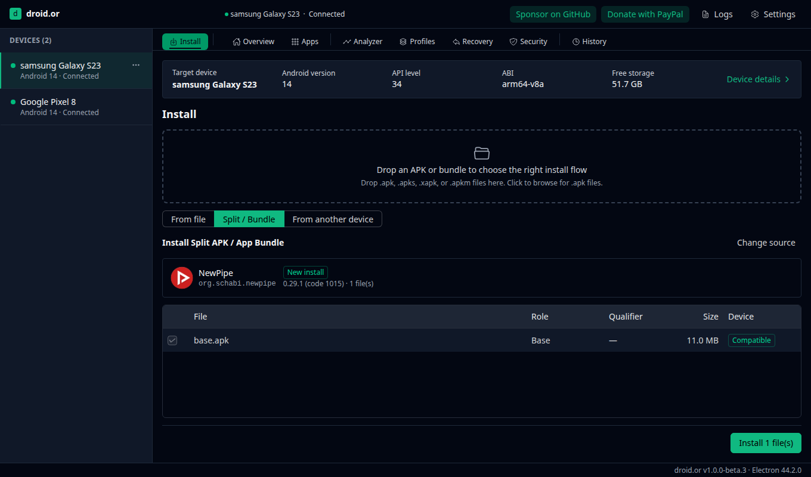
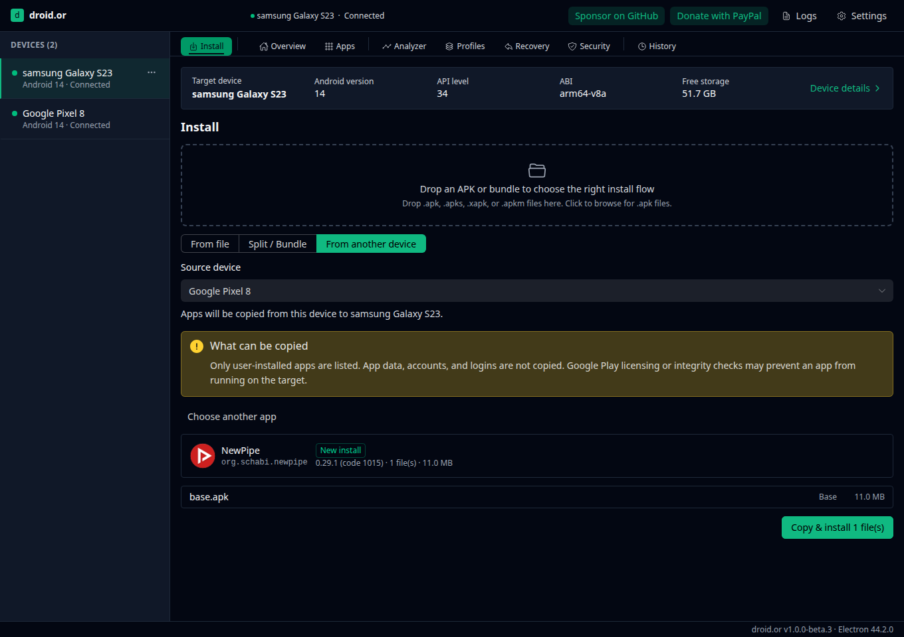

# droid.or

Install APKs on your Android phone from your computer — single APKs, split
bundles, or apps copied straight from another phone — over USB, without root.

[](https://github.com/oscar-renteria/droid.or/releases/latest)
[](https://github.com/oscar-renteria/droid.or/actions/workflows/ci.yml)
[](LICENSE)



## Download

Get the [**latest release**](https://github.com/oscar-renteria/droid.or/releases/latest)
(older versions are on the
[Releases page](https://github.com/oscar-renteria/droid.or/releases)).

| Your computer               | File to download                              |
| --------------------------- | --------------------------------------------- |
| Windows 10/11 (64-bit)      | `droid.or-<version>-x64-setup.exe`            |
| Windows, without installing | `droid.or-<version>-x64-portable.exe`         |
| Linux (64-bit)              | `droid.or-<version>-x86_64.AppImage`          |
| macOS (Apple silicon)       | `droid.or-<version>-arm64.dmg` (experimental) |

The builds are not code-signed yet, so Windows and macOS warn you on the first
start. The release notes explain how to get past that and how to verify your
download with `SHA256SUMS.txt` and GitHub's build provenance. If something
doesn't work, see [Troubleshooting](docs/TROUBLESHOOTING.md).

## System requirements

**Computer**

- Windows 10 or 11 (x64), a 64-bit Linux desktop (x86_64), or a Mac with
  Apple silicon (experimental: not tested by the maintainer).
- A free USB port and a USB cable that carries data, not just power.
- ADB (Android Debug Bridge): droid.or uses one already on your computer or
  downloads Google's official platform-tools for you.
- Windows only: a USB driver for your phone (most manufacturers provide one;
  Google's covers Pixel phones).

**Phone or tablet**

- Android with **USB debugging** turned on (Settings → About phone → tap
  _Build number_ seven times, then Settings → System → Developer options →
  USB debugging). The app walks you through this on first start.
- No root needed. Android 10 to 16 has been tested on real devices; older
  versions are untested (see [`ANDROID_COMPATIBILITY.md`](ANDROID_COMPATIBILITY.md)).

## Installing apps

droid.or opens on **Install**. Pick the phone in the sidebar, then drop a file
or switch the source:

- **From file** — one or more `.apk` files. Each is inspected first, so you
  see whether it's a new install, an update, a reinstall or a downgrade before
  anything happens.
- **Split / Bundle** — `.apks`, `.xapk` and `.apkm` archives, a folder, or a
  set of split APKs. droid.or picks the parts that match the phone (CPU
  architecture, screen density, language) and installs them together.
- **From another device** — connect two phones and copy an installed app
  from one to the other, including its split parts. App data, accounts and
  logins are not copied, and apps that check Google Play licensing may refuse
  to run on the target.

| Split / Bundle                                                                     | From another device                                                                                     |
| ---------------------------------------------------------------------------------- | ------------------------------------------------------------------------------------------------------- |
|  |  |

## Device tools

Grouped after Install, for managing what's already on the phone:

- **Overview** — model, Android version, security patch, battery, storage,
  memory and more.
- **Apps** — search and filter every package; disable, enable, uninstall for
  the current user, clear data, back up APKs, or copy to another device. Every
  change asks for confirmation; the riskiest ones ask you to type it.
- **Analyzer** and **Profiles** — review preinstalled system apps against a
  local knowledge base and apply reviewed debloat profiles. Nothing is removed
  automatically.
- **Recovery** — everything droid.or changed on a phone, restorable one by
  one or all at once.
- **Security** — a few ADB-visible signals (device admin and accessibility
  apps, sideloaded apps) for you to review. This is not a malware scanner.
- **History** and **Logs** — every change and every ADB command, exportable
  for bug reports.

## Privacy

There is no telemetry. The only automatic network request is a once-a-day
check for a newer release on GitHub, which you can switch off in Settings.
Everything else (downloading platform-tools, the optional "Ask AI" analysis,
opening links) happens only when you click it. Details are in
[`SECURITY.md`](SECURITY.md).

## Building from source

```bash
npm install
npm run dev           # run with hot reload
npm run build:linux   # package an AppImage (Windows and macOS build in CI)
```

Node.js 22 (see `.nvmrc`) is required. [`DEVELOPMENT.md`](DEVELOPMENT.md)
covers scripts, tests and the CI pipeline.

## Documentation

- [`docs/TROUBLESHOOTING.md`](docs/TROUBLESHOOTING.md) — first-start
  warnings, phones that don't show up, install errors
- [`ADB.md`](ADB.md) — ADB setup per platform
- [`ANDROID_COMPATIBILITY.md`](ANDROID_COMPATIBILITY.md) — tested devices and
  known differences
- [`SECURITY.md`](SECURITY.md) — security model, local data and network use
- [`ARCHITECTURE.md`](ARCHITECTURE.md) — processes, IPC and code layout
- [`DEVELOPMENT.md`](DEVELOPMENT.md) — development workflow
- [`CONTRIBUTING.md`](CONTRIBUTING.md) — how to contribute

## License

[MIT](LICENSE). Third-party licenses are listed in `THIRD_PARTY_NOTICES.txt`,
which ships with the app.

## Trademarks

Android, Google Play, and ADB are trademarks of Google LLC. droid.or is an
independent open-source project and is not affiliated with, sponsored by, or
endorsed by Google LLC or the Android Open Source Project. All other
trademarks are the property of their respective owners.
