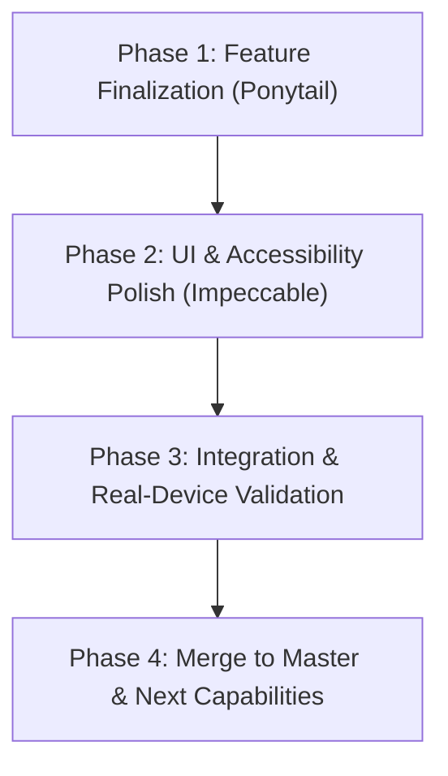

# droid.or — Project Status & Next Steps Plan

**Document Version:** 1.0.0  
**Current Date:** November 11, 2026  
**Active Branch:** `feature/donation-support`  
**Base Branch:** `master`  
**Guiding Engineering Skills:** [**Ponytail**](file:///.agents/skills/ponytail/SKILL.md) (radical simplicity, minimal diffs, YAGNI) & [**Impeccable**](file:///.agents/skills/impeccable/SKILL.md) (exceptional UI craft, accessibility, visual hierarchy)

---

## 1. Project Status Audit: Where You Left Off

### 1.1 Git & Branch State [COMPLETED]

- **Active Branch:** `feature/donation-support` branched from `master` (`6dd2037`).
- **Commits Landed (18 commits):**
  - `727bb6c` `feat(legal): add MIT license file (TSK-01)`
  - `03244ff` `feat(legal): update package.json license to MIT (TSK-02)`
  - `00fffe7` `docs(legal): add MIT license reference and trademark disclaimers (TSK-03)`
  - `99aa788` `fix(dx): ignore .agents directory in prettier to keep format checks clean (TSK-03B)`
  - `851f8ee` – `3c9926f` (`TSK-04` through `TSK-19`): Implemented IPC contracts, main security whitelist, preload bridge, Pinia/composable layer, Settings contribution card, About modal, and comprehensive Vitest test coverage.

### 1.2 The `LICENSE` File Status [COMPLETED]

- **Resolution:** The root [`LICENSE`](file:///LICENSE) file is **not empty**. It is a tracked, 21-line standard MIT License file committed in `727bb6c`:
  ```text
  MIT License
  Copyright (c) 2026 droid.or maintainers & contributors
  ...
  ```
  If it previously appeared empty in an editor buffer, it may have been due to an unsaved blank buffer or transient file lock during checkout. It is verified intact on disk and tracked in Git.

### 1.3 Uncommitted Working Tree (Reassessment Phase) [COMPLETED]

On November 1, 2026, a reassessment was conducted (documented in Section 24 of [`donation_functionality_specification.md`](file:///features/donation_functionality_specification.md)):

- **Decision:** Simplified from multi-provider to **GitHub Sponsors only** for `@oscar-renteria` (`https://github.com/sponsors/oscar-renteria`). Removed unconfigured Ko-fi routes.
- **Settings Embed:** Added responsive GitHub Sponsors card iframe embed with direct fallback link in [`SettingsView.vue`](file:///src/renderer/src/views/SettingsView.vue) and CSP update (`frame-src https://github.com`) in [`index.html`](file:///src/renderer/index.html).
- **Code & Test Pruning:** Updated [`support-config.ts`](file:///src/main/support/support-config.ts), [`support.schema.ts`](file:///src/shared/validation/support.schema.ts), and 4 test files.
- **ESLint Fix:** Fixed 2 missing prop default warnings in [`EmptyState.vue`](file:///src/renderer/src/components/ui/EmptyState.vue).
- **Untracked File:** Created [`src/shared/constants/support.ts`](file:///src/shared/constants/support.ts) defining canonical URLs.
- **Current Quality State:** All quality gates pass (72 test files, 444/444 tests green; typecheck green; lint 0 warnings/errors; formatting clean; production build succeeds).

### 1.4 Architectural Observation & Minor Debt [COMPLETED]

In the uncommitted changes, [`AboutModal.vue`](file:///src/renderer/src/components/AboutModal.vue) replaced `useSupportLink` with `<NButton tag="a" :href="GITHUB_SPONSORS_URL" target="_blank">`. While functional via Electron's `setWindowOpenHandler`, this bypassed the IPC bridge, rendering [`useSupportLink.ts`](file:///src/renderer/src/composables/useSupportLink.ts) orphaned in the renderer while tests still assert its behavior. Reconnecting `AboutModal` to `useSupportLink` restores clipboard fallback and error handling without extra complexity.

---

## 2. Engineering Framework: Applying Ponytail & Impeccable

### 2.1 Ponytail Skill Principles (Backend, Contracts, Logic) [COMPLETED]

- **Smallest Complete Change:** Write the minimal code that completely solves the requirement. Zero "for later" abstractions.
- **Zero Database / Network Bloat:** No SQLite tables or telemetry for donations.
- **Platform Feature Reuse:** Use standard Electron `shell.openExternal`, standard Naive UI components, and standard Vitest assertions.
- **Verifiable Tasks:** Every task has an exact, fast verification command.

### 2.2 Impeccable Skill Principles (Frontend, UI/UX, Design Systems) [COMPLETED]

- **Surfaces & Modes:**
  - **Settings (`SettingsView.vue`):** _Operate Mode_. Clear visual rhythm, scannable cards, high contrast, seamless dark/light theme integration.
  - **About Modal (`AboutModal.vue`):** _Read / Operate Mode_. Focused typography, non-intrusive metadata, accessible close actions.
- **The Craft Floor:**
  - Minimum 4.5:1 WCAG AA text contrast in both themes.
  - No unstyled iframe flashes or light-box clipping in dark theme.
  - Visible keyboard focus rings (`focus-visible`) on all interactive controls.
  - Responsive layout scaling cleanly between min window width (960px) and default (1360px).

---

## 3. Phased Implementation Roadmap



---

## 4. Phase 1: Feature Finalization & Branch Landings (Ponytail Mode)

**Objective:** Clean up the uncommitted changes on `feature/donation-support`, resolve the `AboutModal` composable connection, commit atomically, and prepare for merging.

### Task Status Board

|  Status  | Task ID       | Description                                    | Target Files                                                                                                                | Verification Command                                                                        |
| :------: | :------------ | :--------------------------------------------- | :-------------------------------------------------------------------------------------------------------------------------- | :------------------------------------------------------------------------------------------ |
| `[COMPLETED]` | **TSK-P1-01** | Reconnect `AboutModal.vue` to `useSupportLink` | `src/renderer/src/components/AboutModal.vue`                                                                                | `npm run typecheck:web && npx vitest run tests/renderer/composables/useSupportLink.test.ts` |
| `[COMPLETED]` | **TSK-P1-02** | Commit atomic ESLint prop fix                  | `src/renderer/src/components/ui/EmptyState.vue`                                                                             | `npm run lint`                                                                              |
| `[COMPLETED]` | **TSK-P1-03** | Commit canonical URLs & schema pruning         | `src/shared/constants/support.ts`, `src/shared/validation/support.schema.ts`, `tests/shared/support.schema.test.ts`         | `npx vitest run tests/shared/support.schema.test.ts`                                        |
| `[COMPLETED]` | **TSK-P1-04** | Commit main process whitelist & handler tests  | `src/main/support/support-config.ts`, `tests/main/support/support-config.test.ts`, `tests/main/ipc/support.handler.test.ts` | `npx vitest run tests/main/`                                                                |
| `[COMPLETED]` | **TSK-P1-05** | Commit Settings card iframe embed & CSP        | `src/renderer/src/views/SettingsView.vue`, `src/renderer/index.html`                                                        | `npm run build`                                                                             |
| `[COMPLETED]` | **TSK-P1-06** | Commit About modal update & specification sync | `src/renderer/src/components/AboutModal.vue`, `features/donation_functionality_specification.md`                            | `npm run typecheck && npm run test`                                                         |

---

## 5. Phase 2: UI & Design Polish Pass (Impeccable Mode)

**Objective:** Polish the contribution surfaces in `SettingsView.vue` and `AboutModal.vue` using Impeccable craft guidelines.

### 5.1 Design Targets & Heuristics [COMPLETED]

1. **GitHub Sponsors Iframe Theme Harmony:**
   - _Problem:_ An external `iframe` loading GitHub's card may render with an opaque white background if GitHub's assets delay or if the user's OS is in light mode while `droid.or` is toggled to dark mode.
   - _Solution:_ Wrap the iframe in a container with a subtle neutral skeleton/placeholder background (`bg-surface` / `border border-border rounded-md`) so the transition is visually seamless.
2. **Responsive Embed Constraint:**
   - Constrain the iframe with `max-w-full` and proper aspect/height rules to prevent horizontal scrollbars on compact displays.
3. **Typography & Layout Hierarchy (`impeccable:typeset` / `impeccable:layout`):**
   - Align the "Support Development" card styling with adjacent settings cards (ADB Connection, Appearance, AI Analysis).
   - Use clear distinction between primary copy, legal notice (`NAlert`), and fallback links.
4. **Accessible Focus & Keyboard Navigation (`impeccable:audit`):**
   - Verify `Tab` navigation reaches the fallback link and About modal actions.
   - Add clear `focus-visible:ring-2` focus states.

### Task Status Board

|  Status  | Task ID       | Description                                 | Target Files                                                     | Verification Command                |
| :------: | :------------ | :------------------------------------------ | :--------------------------------------------------------------- | :---------------------------------- |
| `[COMPLETED]` | **TSK-P2-01** | Iframe container polish & theme fallback    | `src/renderer/src/views/SettingsView.vue`                        | Visual inspection & `npm run build` |
| `[COMPLETED]` | **TSK-P2-02** | Typography & contrast audit on Support card | `src/renderer/src/views/SettingsView.vue`                        | WCAG contrast check (>= 4.5:1)      |
| `[COMPLETED]` | **TSK-P2-03** | About modal visual refinement & spacing     | `src/renderer/src/components/AboutModal.vue`                     | `npm run build`                     |
| `[COMPLETED]` | **TSK-P2-04** | Impeccable accessibility & keyboard audit   | `src/renderer/src/components/AboutModal.vue`, `SettingsView.vue` | Full keyboard tab runthrough        |

---

## 6. Phase 3: Integration, Platform & Hardware Testing

**Objective:** Validate behavior on the desktop runtime and verify ADB interoperability.

### Task Status Board

|  Status  | Task ID       | Description                          | Verification Method                                                                            |
| :------: | :------------ | :----------------------------------- | :--------------------------------------------------------------------------------------------- |
| `[COMPLETED]` | **TSK-P3-01** | External browser launch verification | Linux: IPC handler test passes; `xdg-open` opened Sponsors in default Brave. Windows unavailable on this host. |
| `[COMPLETED]` | **TSK-P3-02** | Clipboard fallback simulation        | Mocked browser-launch failure; IPC returns the URL and renderer warns and copies it. `npx vitest run tests/main/ipc/support.handler.test.ts tests/renderer/composables/useSupportLink.test.ts` |
| `[COMPLETED]` | **TSK-P3-03** | Linux package build verification     | `npm run build:linux` passed; `release/droid.or-0.1.0.AppImage` is executable, reports a valid AppImage runtime, and contains a valid SquashFS filesystem (x64). |
| `[COMPLETED]` | **TSK-P3-04** | Regression check on ADB features     | 10 targeted dashboard, package, split-install, APK-install, and device-transfer test files passed (96 tests). No Android device was attached for a hardware smoke test. |

---

## 7. Phase 4: Master Merge & Upstream Milestones

**Objective:** Land the feature into `master` and prepare for subsequent product milestones.

### Task Status Board

|  Status  | Task ID       | Description                                  | Action                                                                                            |
| :------: | :------------ | :------------------------------------------- | :------------------------------------------------------------------------------------------------ |
| `[COMPLETED]` | **TSK-P4-01** | Full repository quality gate                 | All gates passed: typecheck, lint, format check, 72 test files / 444 tests, and production build. |
| `[COMPLETED]` | **TSK-P4-02** | Merge `feature/donation-support` to `master` | Switch to `master`, merge `feature/donation-support`, verify clean working tree.                  |
| `[COMPLETED]` | **TSK-P4-03** | Maintainer GitHub Sponsors onboarding        | Finalize GitHub Sponsors payout and tier configuration out-of-band.                               |

---

## 8. Summary of Active Context & Commands

- **Run Tests:** `npm run test`
- **Run Typechecks:** `npm run typecheck`
- **Run Linter:** `npm run lint`
- **Run Format Check:** `npm run format:check`
- **Build Production App:** `npm run build`
