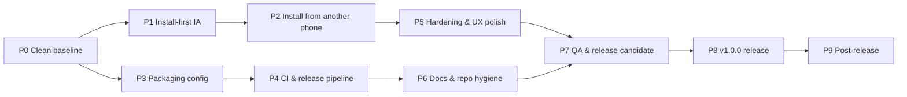

# droid.or — Roadmap to Production

**Assessment date:** 2026-11-14 · **Baseline:** `master` @ `2d9cba8` · **Version:** `0.1.0`
**Implementation branch:** `feature/roadmap-to-production`

**Target state:** A public GitHub repository where pushing a version tag runs a
pipeline that builds, verifies and publishes to GitHub Releases:
**Windows x64** (portable `.exe` + NSIS installer), **Linux x64**
(`.AppImage`) and an **experimental, unsigned macOS arm64** `.dmg` — for an
app whose **primary function is installing apps onto Android devices**, from a
local file or copied from another connected phone.

**Status of decisions:** all settled on 2026-11-14 (see §2).

---

## 1. Assessment

### 1.1 Verified facts (checked on 2026-11-14)

| Area                        | State                                                                                                                                                                                                                                                                                                   |
| --------------------------- | ------------------------------------------------------------------------------------------------------------------------------------------------------------------------------------------------------------------------------------------------------------------------------------------------------- |
| Quality gates               | `typecheck` ✅, `lint` ✅, `test` ✅ (72 files / 449 tests), `format:check` ✅                                                                                                                                                                                                                           |
| Architecture                | Electron 44 + Vue 3 + Pinia + Naive UI; sandboxed renderer, `contextIsolation`, Zod-validated IPC, single-instance lock, CSP in `index.html`                                                                                                                                                            |
| Install features            | Single APK, split/bundle (`.apks`/`.xapk`/`.apkm`/directory) with pre-install analysis; device-to-device copy implemented in `device-transfer.service.ts`                                                                                                                                               |
| Install-from-other-phone UX | Only reachable via `CopyToDeviceDialog` inside **Apps** view, starting from the _source_ device. Not discoverable from **Install**.                                                                                                                                                                     |
| Navigation                  | Default route `/overview`; Install is tab 3 of 8; product is positioned as a "debloat" tool (README, `package.json` description)                                                                                                                                                                        |
| Packaging                   | `electron-builder.yml`: Linux `AppImage`; Windows `nsis` + `portable`; macOS `dmg` + `zip`. Unsigned.                                                                                                                                                                                                   |
| CI                          | `.github/workflows/build.yml` builds 3 OSes on every push to `master`, uploads workflow artifacts only. **No release workflow, no tags, no GitHub Release exists.** No PR workflow, no Dependabot, actions not SHA-pinned, no concurrency control. Last runs: green; one older run had macOS cancelled. |
| Repo                        | `oscar-renteria/droid.or` is **public**, issues enabled, no issue/PR templates                                                                                                                                                                                                                          |
| Secrets                     | AI API key encrypted via Electron `safeStorage` ✅                                                                                                                                                                                                                                                      |
| ADB                         | Detects system `adb`, custom path, or downloads `platform-tools-latest` from `dl.google.com` into `userData` (HTTPS, no checksum — Google publishes none for `latest`)                                                                                                                                  |
| Data location               | `userData` (`%APPDATA%\droid.or` on Windows even for the portable `.exe`)                                                                                                                                                                                                                               |
| Updates                     | None. `release/linux-unpacked/resources/app-update.yml` is generated but no updater is wired.                                                                                                                                                                                                           |
| `package.json`              | Author, repository, homepage, and issue URL are set; description leads with Android app installation                                                                                                                                                                                                    |
| Working tree                | P0-01 through P0-06 are committed on `feature/roadmap-to-production`                                                                                                                                                                                                                                    |
| Docs                        | `features/` contains only this active production roadmap; completed plans were removed under P0-03                                                                                                                                                                                                     |

### 1.2 Assumptions

All former assumptions (A1–A5) were confirmed or replaced by decisions in §2.
Remaining unverified technical points are flagged inline as **(verify)**.

### 1.3 Main risks

| #   | Risk                                                                                                                                                                                        | Impact                                              | Mitigation (task)                                                                                     |
| --- | ------------------------------------------------------------------------------------------------------------------------------------------------------------------------------------------- | --------------------------------------------------- | ----------------------------------------------------------------------------------------------------- |
| R1  | Unsigned Windows `.exe` (portable and setup) triggers SmartScreen; some AV engines flag unsigned Electron portables                                                                         | Users abort download/launch                         | Document clearly (REL-07); SignPath OSS signing after v1.0 (POST-02)                                  |
| R9  | macOS build is unsigned/unnotarized and **never tested by the maintainer** (no Mac). Gatekeeper blocks it; on macOS 15+ users must use System Settings → Privacy & Security → "Open Anyway" | Broken or unlaunchable macOS build ships unnoticed  | Label "experimental" in release notes (REL-07); CI smoke test (REL-04); ask community testers (QA-07) |
| R10 | Two Windows artifacts (portable + NSIS) double Windows QA; NSIS adds install/uninstall/upgrade paths                                                                                        | More test effort, more support cases                | Dedicated QA steps (QA-02)                                                                            |
| R2  | Ubuntu 23.10+/24.04 restricts unprivileged user namespaces → Electron AppImages may fail to start without an AppArmor profile or `--no-sandbox`. **Not yet verified for this app.**         | App doesn't launch on the most common Linux desktop | Test on 24.04 (QA-03); document workaround (DOC-03)                                                   |
| R3  | AppImage requires `libfuse2`, missing by default on Ubuntu 22.04+                                                                                                                           | Launch fails with FUSE error                        | Document (DOC-03)                                                                                     |
| R4  | Windows needs OEM/Google USB drivers for ADB                                                                                                                                                | "No device" support requests                        | First-run onboarding (UX-03), DOC-03                                                                  |
| R5  | Windows portable `.exe` self-extracts to `%TEMP%` on every start → slow start (several seconds)                                                                                             | Perceived as broken                                 | Measure (QA-02); document; consider `unpackDirName`                                                   |
| R6  | Device-to-device copy only works for apps in user storage and may hit licence/Play-integrity checks on target                                                                               | Users expect "clone any app"                        | Clear UI copy on limits (INS-08)                                                                      |
| R7  | No auto-update for the Windows portable target (electron-updater does not support it); unsigned macOS can't auto-update either                                                              | Users stay on old versions                          | Update _check_ + link to release for all targets (UPD-01..04)                                         |
| R8  | Runtime download of platform-tools has no integrity check beyond TLS + `adb version`                                                                                                        | Supply-chain exposure                               | Accept for v1.0, documented in `SECURITY.md` (DOC-05)                                                 |

---

## 2. Decisions (settled 2026-11-14)

| ID  | Topic                         | Decision                                                                                                                    | Consequence                                   |
| --- | ----------------------------- | --------------------------------------------------------------------------------------------------------------------------- | --------------------------------------------- |
| D1  | macOS                         | **Release as "experimental", arm64 only, unsigned**, built on GitHub's `macos-latest` runner. Maintainer has no Mac.        | PKG-01, REL-03/04/07, QA-07, risk R9          |
| D2  | Windows artifacts             | **Portable `.exe` + NSIS installer**, both x64                                                                              | PKG-02, QA-02, risk R10                       |
| D3  | Windows data location         | **`%APPDATA%`** (Electron default) for both portable and installed                                                          | No code change; documented in DOC-03          |
| D4  | Updates                       | **Daily update check + "Download" link** to the GitHub release, opt-out in Settings, for all targets                        | UPD-01..04; `publish: null` in builder config |
| D5  | Landing view & secondary tabs | **App opens on Install**. Nav = Install as a separate primary action, then device views led by Overview (`Overview · Apps`), then **"Device tools"** (Analyzer, Profiles, Recovery, Security), then History | INS-01, INS-02, INS-02b                       |
| D6  | Versioning                    | `v1.0.0-beta.N` (pipeline) → `v1.0.0-rc.N` (QA) → `v1.0.0`                                                                  | REL-08, QA-01, REL-10                         |
| D7  | Architectures                 | **x64** for Windows/Linux; **arm64** for macOS                                                                              | arm64 Win/Linux in backlog (POST-03)          |
| D8  | Windows code signing          | **Unsigned v1.0**; apply to SignPath Foundation (free OSS signing) after release                                            | POST-02                                       |
| D9  | Device-to-device copy scope   | **One app per copy** in v1.0; batch copy deferred                                                                           | POST-01                                       |
| D10 | Uncommitted PayPal work       | **Review and commit** as part of the baseline                                                                               | P0-01                                         |
| D11 | Optional items in v1.0        | **In scope:** first-run onboarding (UX-03), persistent log file (HRD-02), third-party notices (PKG-08), provenance (REL-06) | Added to critical path (§4)                   |

---

## 3. Phases overview

P1–P2 (product) and P3–P4 (pipeline) can run in parallel.

**Conventions:** each task = one commit (Conventional Commits). "Done when"
is the acceptance criterion. Quality gate =
`npm run typecheck && npm run lint && npm run format:check && npm test`.

---

## Phase 0 — Clean baseline

| ID    | Task                                                                                                                                            | Files                                                                                                | Done when                                                 |
| ----- | ----------------------------------------------------------------------------------------------------------------------------------------------- | ---------------------------------------------------------------------------------------------------- | --------------------------------------------------------- |
| **[DONE] P0-01** | Review and commit the PayPal donation work (D10)                                                                                                | `src/main/support/*`, `src/shared/constants/support.ts`, `AppShell.vue`, `SettingsView.vue`, 4 tests | Committed as `2d9cba8`; tests and production build green |
| **[DONE] P0-02** | Exclude tool output from the repo: add `.impeccable/` to `.gitignore` and `.prettierignore`                                                     | `.gitignore`, `.prettierignore`                                                                      | Ignore rules added; tracked tool output untracked; `npm run format:check` passes |
| **[DONE] P0-03** | Archive finished plans: move `features/PLAN.md`, `features/paypal_donation_button.md` to `docs/archive/` (or delete)                            | `features/`, `docs/archive/`                                                                         | Completed plans deleted; `features/` contains only this open roadmap |
| **[DONE] P0-04** | Pin `yauzl`, `yazl`, `@types/yauzl`, `@types/yazl` to exact versions like the rest                                                              | `package.json`, `package-lock.json`                                                                  | Exact versions in manifest and lockfile; `npm ci` succeeds; quality gate passes |
| **[DONE] P0-05** | Fill `package.json` metadata: `author` (name + public contact), `repository`, `homepage`, `bugs`; update `description` to install-first wording | `package.json`                                                                                       | `npm pkg get repository author` returns maintainer-provided values; quality gate passes |
| **[DONE] P0-06** | Run `npm audit --omit=dev`; fix or document each high/critical finding                                                                          | `package.json`, `package-lock.json`                                                                 | Upgraded `source-map-js` to 1.2.2, Vite to 7.3.8, and Zod to 4.6.7; audit reports zero production vulnerabilities; quality gate passes |

---

## Phase 1 — Install-first information architecture

Goal: launching the app lands on **Install**; installing is the obvious primary action.

| ID     | Task                                                                                                                                                               | Files                                                                          | Done when                                                                                              |
| ------ | ------------------------------------------------------------------------------------------------------------------------------------------------------------------ | ------------------------------------------------------------------------------ | ------------------------------------------------------------------------------------------------------ |
| **[DONE] INS-01** | Change root redirect `/` → `/install`                                                                                                                              | `src/renderer/src/router/index.ts`                                             | App opens on Install; typecheck passes                                                                  |
| **[DONE] INS-02** | Split the nav into an **action** and the **device views** (D5): `[⬇ Install]` ‖ `Overview · Apps` │ `Analyzer · Profiles · Recovery · Security` (Device tools) │ `History`. Install is the leftmost item, styled as the primary action (accent fill/pill, not a plain tab), with a wider gap after it. Overview leads the device group as the device's "home". Route names stay unchanged | `components/layout/AppShell.vue` (`tabs`, `navGroups`, Install styling) | Install is visually distinct from the tabs; Overview is the first device view; keyboard order matches visual order; contrast ≥ 4.5:1 in both themes |
| **[DONE] INS-02b** | Target-device strip at the top of Install: device name, Android version/API level, ABI, free storage, plus a "Device details →" link to Overview. Data comes from the existing dashboard IPC; no new ADB calls | `views/InstallView.vue`, new `components/install/TargetDeviceStrip.vue` | Install shows what an install depends on without leaving the page; the link opens Overview |
| **[DONE] INS-03** | Restructure `InstallView` tabs into three sources: **From file** (single `.apk`), **Split / Bundle**, **From another device**                                      | `views/InstallView.vue`, `components/install/SplitApkInstallPanel.vue`          | Three tabs render; existing file and split install flows remain unchanged                              |
| **[DONE] INS-04** | Make the file drop zone accept `.apk`, `.apks`, `.xapk`, `.apkm` in one place and route automatically to the single or split flow (keep tabs as explicit fallback) | `views/InstallView.vue`, `components/install/SingleApkInstallPanel.vue`, `components/install/SplitApkInstallPanel.vue`, `utils/install-file-routing.ts`, `tests/renderer/utils/install-file-routing.test.ts` | One shared drop zone routes APKs to single install and archives/split sources to analysis; unit tests cover extension mapping |
| **[DONE] INS-05** | Persist the last-used Install source tab per session                                                                                                               | `stores/apk-install.store.ts`, `views/InstallView.vue`, `tests/renderer/stores/apk-install.store.test.ts` | The selected tab remains after navigating away and back during the app session; queue resets do not change it |
| **[DONE] INS-06** | Install-specific empty state when no device is connected: steps to enable USB debugging + "Waiting for device…" instead of generic gate text | `InstallView.vue`, `DeviceGate.vue` props | Empty state shows concrete USB setup guidance and waiting status; other device views keep their existing gate text |
| **[DONE] INS-07** | Update README "What it does": lead with Install / Copy between devices; debloat features listed under "Device tools" | `README.md` | README leads with APK install and cross-device app copy; debloat features are grouped under Device tools |

## Phase 2 — Install from another phone (first-class flow)

Goal: on **Install → From another device**, the user picks a _source_ device and
an app; the _target_ is the currently selected device. Reuse the existing
backend (`analyzeDeviceTransfer` / `performDeviceTransfer`) — no new install logic.

| ID     | Task                                                                                                                                                                                                   | Files                                                                                                                                                                                   | Done when                                                                                                                |
| ------ | ------------------------------------------------------------------------------------------------------------------------------------------------------------------------------------------------------ | --------------------------------------------------------------------------------------------------------------------------------------------------------------------------------------- | ------------------------------------------------------------------------------------------------------------------------ |
| **[DONE] INS-08** | New panel `DeviceTransferPanel.vue`: source device selector (connected devices ≠ target); explanatory copy on limits (only user-installed apps; licensing/Play checks may block the app on the target) | `components/install/DeviceTransferPanel.vue` | Panel renders, excludes the target from connected source choices, and prompts to connect a second device when needed |
| **[DONE] INS-09** | IPC: list user-installed (`pm list packages -3`) packages of an arbitrary source serial, with label/version, without changing the sidebar selection | `src/main/ipc/handlers/device-transfer.handler.ts`, `src/shared/constants/ipc-channels.ts`, `src/shared/validation/device-transfer.schema.ts`, `src/preload/index.ts`, `droidor-api.ts` | Handler test with `FakeAdbClient` returns only third-party packages for the given serial; invalid serial rejected by Zod |
| **[DONE] INS-10** | Searchable app list for the source device in the panel (name, package, version, size if available) | `DeviceTransferPanel.vue`, `stores/device-transfer.store.ts` | Search filters by name, package, or version; loading, error, and empty states are distinct |
| **[DONE] INS-11** | Extract the analyze → review → install steps from `CopyToDeviceDialog.vue` into a reusable component; use it in both the dialog and the new panel | `components/install/DeviceTransferReview.vue`, `CopyToDeviceDialog.vue`, `DeviceTransferPanel.vue` | Both entry points share the same review and install workflow; dialog analysis/transfer behavior is retained |
| **[DONE] INS-12** | Device-pair safety: lock source/target at analysis time (as the dialog already does), discard results when either disconnects | `DeviceTransferPanel.vue`, `stores/device-transfer.store.ts` | Store tests: disconnecting source or target resets analysis |
| **[DONE] INS-13** | Progress feedback during pull (per-file) and install; cancel disabled while installing | `device-transfer.handler.ts`, `device-transfer.store.ts`, `DeviceTransferReview.vue`, `DeviceTransferPanel.vue` | Multi-split transfer shows pull, check, and install status; source/app actions stay disabled while busy |
| **[DONE] INS-15** | Operation history entry shows source → target device for transfers | `operation-history.repository.ts`, `migrations.ts`, `operation.schema.ts`, `split-install.service.ts`, `HistoryView.vue` | History row names both devices |

---

## Phase 3 — Packaging configuration

| ID     | Task                                                                                                                                                                                                                                                     | Files                                                          | Done when                                                                                       |
| ------ | -------------------------------------------------------------------------------------------------------------------------------------------------------------------------------------------------------------------------------------------------------- | -------------------------------------------------------------- | ----------------------------------------------------------------------------------------------- |
| **[DONE] PKG-01** | macOS (D1): `dmg` only, arm64, no Developer ID signing/notarization; require an ad-hoc signature | `electron-builder.yml`, `.github/workflows/build.yml`, `DEVELOPMENT.md` | macOS CI verifies the arm64 app signature with `codesign --verify --deep` before uploading the DMG |
| **[DONE] PKG-02** | Windows (D2): `portable` + `nsis`, both `x64`; keep `oneClick: false` | `electron-builder.yml`, `.github/workflows/build.yml`, `DEVELOPMENT.md` | Windows CI verifies `droid.or-<ver>-x64-portable.exe` and `droid.or-<ver>-x64-setup.exe` |
| **[DONE] PKG-03** | Linux: `AppImage`, x64, artifact name `droid.or-<ver>-x86_64.AppImage` | `electron-builder.yml`, `.github/workflows/build.yml`, `DEVELOPMENT.md` | Linux CI verifies the deterministic artifact name |
| **[DONE] PKG-04** | Disable electron-builder publishing; releases stay workflow-controlled | `electron-builder.yml`, `DEVELOPMENT.md` | Linux package build produces no `app-update.yml` or `latest*.yml` |
| **[DONE] PKG-05** | Set Windows legal trademarks; verify product, version, copyright, and company metadata from the existing package name, version, and author | `electron-builder.yml`, `package.json`, `.github/workflows/build.yml`, `DEVELOPMENT.md` | Windows CI verifies file properties on both `.exe` artifacts |
| **[DONE] PKG-06** | Verify electron-builder's default native rebuild and automatic `*.node` unpacking with packaged database smoke tests | `electron-builder.yml`, `.github/workflows/build.yml`, `DEVELOPMENT.md` | Linux and Windows CI open a database through their packaged Electron runtimes |
| **[DONE] PKG-07** | Exclude dependency test folders/spec files from the app archive and verify only production content ships | `electron-builder.yml`, `.github/workflows/build.yml`, `DEVELOPMENT.md` | Linux CI verifies allowed archive roots and rejects tests and app source maps |
| **[DONE] PKG-08** | Generate production-dependency notices at build time, bundle them as an extra resource, and expose them from About | `scripts/generate-third-party-notices.mjs`, `package.json`, `electron-builder.yml`, `AboutModal.vue` | Linux and Windows builds verify the resource and About opens it through the system viewer |
| **[DONE] PKG-09** | Keep Google platform-tools out of distributables; download them at runtime to the per-user managed ADB directory | `electron-builder.yml`, `ADB.md` | Linux package and app archive contain no `adb` binary; runtime download behavior is documented |

## Phase 4 — CI and release pipeline

| ID     | Task                                                                                                                                                                                                                                                                                     | Files                                              | Done when                                                                                          |
| ------ | ---------------------------------------------------------------------------------------------------------------------------------------------------------------------------------------------------------------------------------------------------------------------------------------- | -------------------------------------------------- | -------------------------------------------------------------------------------------------------- |
| **[DONE] CI-01** | Add PR and `master` CI with an Ubuntu quality gate and an Ubuntu/Windows test matrix | `.github/workflows/ci.yml`, `DEVELOPMENT.md` | Workflow exposes quality and test checks on pull requests |
| **[DONE] CI-02** | Add `concurrency: { group: ${{ github.workflow }}-${{ github.ref }}, cancel-in-progress: true }` | `.github/workflows/ci.yml`, `.github/workflows/build.yml` | Both workflows cancel superseded runs per workflow and ref |
| **[DONE] CI-03** | Least-privilege `permissions: contents: read` at workflow level; lint workflows with actionlint in CI | `.github/workflows/ci.yml`, `.github/workflows/build.yml` | Both workflows default to `contents: read`; CI runs actionlint (incl. shellcheck) on every PR. Local YAML parse passes; first actionlint result comes from the first GitHub run |
| **[DONE] CI-04** | Pin all third-party actions to commit SHAs; add Dependabot for `github-actions` and `npm` (weekly, grouped) | workflows, `.github/dependabot.yml` | All `actions/*` steps pinned to commit SHAs (version in comment); weekly grouped Dependabot updates for actions and npm configured. PRs appear once the branch is on `master` |
| **[DONE] CI-05** | Read Node version from `.nvmrc` (add it) instead of hard-coding `22` | `.nvmrc`, workflows, `DEVELOPMENT.md` | All `setup-node` steps use `node-version-file: .nvmrc`; no hard-coded Node version in workflows |
| **[DONE] CI-06** | Retire `build.yml` or reduce it to `workflow_dispatch` snapshot builds (same 3-OS matrix as release) | `.github/workflows/build.yml`, `DEVELOPMENT.md` | `build.yml` runs only on `workflow_dispatch` (snapshot) and `workflow_call` (release); pushes run `ci.yml` only. Concurrency group uses a fixed `build-` prefix so a call from `release.yml` cannot cancel its caller |
| **[DONE] REL-01** | New `release.yml`, trigger `push: tags: ['v*']` | `.github/workflows/release.yml` | Workflow triggers on `v*.*.*` tags, rejects non-SemVer tags, never cancels a running release. Appears in Actions once pushed |
| **[DONE] REL-02** | Job `verify`: fail if tag `vX.Y.Z` ≠ `package.json` version; run quality gate | `.github/workflows/release.yml` | Job `verify` fails fast when tag ≠ `v` + `package.json` version, then runs typecheck, lint, format check and tests |
| **[DONE] REL-03** | Job `build` (matrix `ubuntu-latest`, `windows-latest`, `macos-latest`): `npm ci` → `npm run build:<os>` → upload artifact. macOS job `continue-on-error: true` so an experimental failure never blocks Windows/Linux | `.github/workflows/release.yml`, `.github/workflows/build.yml` | Release job `build` reuses `build.yml` (3-OS matrix incl. all artifact checks) after `verify`; macOS matrix entry is `continue-on-error`, so its failure only warns |
| **[DONE] REL-04** | Packaged smoke test per OS: launch the artifact with a `--smoke-test` flag that opens the DB, creates the window, and exits 0 (Linux under `xvfb-run`; Windows: portable and installed via `setup.exe /S`; macOS: mounted `.app`) | `src/main/smoke-test.ts`, `src/main/index.ts`, `.github/workflows/build.yml`, tests | `--smoke-test` uses a throwaway profile, checks SQLite, waits for preload + Vue mount, exits 0/1 (90 s timeout). Passes locally against the production bundle; it immediately caught a broken sandboxed preload (fixed in `64c69da`). CI launches the AppImage (xvfb), the Windows portable and the silently installed NSIS app, and the macOS app from the DMG; first CI result pending (REL-08) |
| **[DONE] REL-05** | Job `publish` (`needs: build`, `permissions: contents: write`): download artifacts, create `SHA256SUMS.txt`, `gh release create $TAG --draft --generate-notes` with all files; tags containing `-` marked `--prerelease` | `.github/workflows/release.yml`, `.github/workflows/build.yml` | Job `publish` (only job with `contents: write`) downloads all `droid-or-*` artifacts, writes `SHA256SUMS.txt`, and runs `gh release create --draft --verify-tag --generate-notes`; `-` in the tag adds `--prerelease`. Windows upload narrowed to the two named `.exe` files |
| **[DONE] REL-06** | Build provenance: `actions/attest-build-provenance` for all binaries (D11) | `.github/workflows/release.yml` | `attest-build-provenance` (SHA-pinned v4.2.2) attests every file in `SHA256SUMS.txt`; publish job gains `id-token`/`attestations: write`. `gh attestation verify` check happens in REL-08 |
| **[DONE] REL-07** | Release notes template with: download table (portable vs installer explained), SHA256 + attestation instructions, SmartScreen "More info → Run anyway", Linux `chmod +x` / `libfuse2` / sandbox notes, **macOS marked "experimental — untested by maintainer"** with "Open Anyway" steps | `.github/release-template.md`, `.github/workflows/release.yml` | Template (downloads table, checksum + attestation verification, SmartScreen, Linux FUSE/sandbox/udev, macOS "experimental" + Open Anyway) is rendered with version/repo and prepended to the generated changelog of every draft |
| **[DONE] REL-08** | Dry run: push a beta tag, verify draft prerelease, download all artifacts | release runs for `v1.0.0-beta.1`–`beta.3` | Green on the 3rd run (`43644981468`) after fixing the Windows exe name and replacing a Windows check that could not work (PowerShell does not wait for GUI executables). Draft prerelease has portable + setup `.exe`, `.AppImage`, `.dmg`, `SHA256SUMS.txt`; checksums OK; all 4 binaries have SLSA v1 provenance from `release.yml`; the downloaded AppImage passes the smoke test with sandbox on. All 3 OS launch smoke tests pass in CI (incl. macOS). Draft kept for maintainer review; beta tags remain |
| REL-09 | Branch protection on `master`: require `ci.yml` checks, no force-push; tag protection for `v*`                                                                                                                                                                                           | GitHub settings                                    | Settings applied                                                                                   |

---

## Phase 5 — Hardening and UX polish

| ID     | Task                                                                                                                                           | Files                                                       | Done when                                              |
| ------ | ---------------------------------------------------------------------------------------------------------------------------------------------- | ----------------------------------------------------------- | ------------------------------------------------------ |
| **[DONE] UPD-01** | Main-process service: fetch `https://api.github.com/repos/<owner>/droid.or/releases/latest` at most once per day, compare SemVer, cache result | `src/main/update/*`, `src/shared/constants/repository.ts`, `src/shared/validation/update.schema.ts`, tests | `UpdateCheckService` queries `/releases/latest` at most every 24 h (cached in `app_settings`), SemVer 2.0 precedence incl. prereleases; release URL built from the validated tag. Tests cover newer/same/older/beta→stable/interval/offline/rate-limited/malformed |
| **[DONE] UPD-02** | IPC + preload for update status | `ipc-channels.ts`, `update.handler.ts`, `app-context.ts`, preload, `droidor-api.ts`, test | `getUpdateStatus` (Zod-validated in main and preload) and argument-less `openReleasePage` (URL resolved in main, passes the https allow-list); handler tests cover both and the refusal paths |
| **[DONE] UPD-03** | Unobtrusive header badge "Update available → Download" opening the release page via existing safe-link path | `stores/update.store.ts`, `AppShell.vue`, store test | Quiet header button "Update <version>" appears only when `updateAvailable`; any failure keeps it hidden; click opens the release page via `openReleasePage`. Store tests cover shown/hidden/failure. Not yet seen live — needs a published stable release newer than the running build |
| **[DONE] UPD-04** | Settings toggle "Check for updates" (default on), documented in `SECURITY.md` as the only automatic network call | `SettingsView.vue`, `update-check.service.ts`, `update.handler.ts`, preload, store, `SECURITY.md`, tests | Settings → Updates switch (default on, stored as `update_check.enabled`); off = no request and no badge (service test); re-enabling checks immediately. `SECURITY.md` documents it as the only automatic network request |
| **[DONE] HRD-01** | Global `uncaughtException` / `unhandledRejection` handling in main: log, show dialog, keep DB consistent | `src/main/crash-handlers.ts`, `src/main/index.ts`, test | Uncaught exceptions and startup failures: logged with stack, error dialog naming the log folder (suppressed in smoke mode), DB closed, exit 1. Unhandled rejections: logged only (a dialog per rejection would be noise). Verified by forcing a throw in the built app: exit 1 + stack in `droid-or.log`; dialog path covered by unit tests |
| **[DONE] HRD-02** | Persistent rotating log file in `userData/logs` (plain `fs`, size-capped); "Open logs folder" in Logs view | `src/main/logging/file-logger.ts`, `adb-command-log.ts`, `app-context.ts`, `logs.handler.ts`, preload, `LogsView.vue`, `SECURITY.md`, tests | `userData/logs/droid-or.log`, 1 MB × 3 files, synchronous and never throwing; records startup, errors and every ADB command. Logs view has "Open Log Folder". Verified: the smoke run wrote the start line; rotation covered by tests |
| **[DONE] HRD-03** | Renderer error boundary (`app.config.errorHandler`) → toast + log via IPC | `src/renderer/src/main.ts`, `stores/error-report.store.ts`, `components/ui/ErrorToaster.vue`, `App.vue`, `logs.handler.ts`, schema, preload, tests | Vue `errorHandler` + window `error`/`unhandledrejection` → Zod-bounded report written to `droid-or.log` and a themed toast (same message at most once per 5 s). Verified: a forced renderer rejection appears in the log with stack; toast logic covered by store tests |
| **[DONE] HRD-04** | Electron hardening review: `will-navigate` blocked to non-app URLs, `webSecurity` default, permission request handler denies all | `src/main/window-security.ts`, `src/main/index.ts`, `SECURITY.md`, test | `will-navigate` limited to the app page; `window.open` always denied, only allow-listed https URLs go to the browser (previously any URL was passed to `openExternal`); permissions deny-all except clipboard write; `<webview>` blocked app-wide; secure `webPreferences` explicit. Checklist in `SECURITY.md`; smoke test passes with hardening on |
| HRD-05 | Re-evaluate CSP `frame-src https://github.com` — remove if the Sponsors iframe is no longer used                                               | `src/renderer/index.html`                                   | CSP minimal                                            |
| HRD-06 | Large APK handling: test install of a > 1 GB split bundle; ensure staging dir cleanup on cancel/failure                                        | split-install service + manual test                         | Temp dir empty after failure                           |
| HRD-07 | Database migration safety: back up `droid-or.db` before running migrations on version change                                                   | `persistence/migrations.ts`                                 | Test: failed migration restores backup                 |
| UX-01  | Finish `features/UX_redesign.md` Phase 6 (accessibility sweep) for Install views first                                                         | install components                                          | Keyboard-only install flow works; focus visible        |
| UX-02  | Finish UX redesign Phase 7 (verification)                                                                                                      | —                                                           | Checklist complete                                     |
| UX-03  | First-run onboarding (one screen): enable developer options + USB debugging, ADB status, Windows driver hint, link to `ADB.md`                 | new component, `settings.store.ts` (seen flag)              | Shown once; re-openable from Settings                  |

## Phase 6 — Documentation and repository hygiene

| ID     | Task                                                                                                                                                        | Files                                                          | Done when                                      |
| ------ | ----------------------------------------------------------------------------------------------------------------------------------------------------------- | -------------------------------------------------------------- | ---------------------------------------------- |
| DOC-01 | README: download section linking to latest release, screenshots of Install flows, system requirements                                                       | `README.md`, `docs/images/`                                    | README shows install-first screenshots         |
| DOC-02 | Rewrite `DEVELOPMENT.md` build/CI sections for the new pipeline; document release procedure (bump version → tag → review draft → publish)                   | `DEVELOPMENT.md`, `RELEASING.md`                               | A second maintainer could release from the doc |
| DOC-03 | Troubleshooting page: Windows USB drivers & SmartScreen; Linux udev rules, `libfuse2`, AppImage sandbox on Ubuntu 24.04; "unauthorized" device              | `ADB.md` / `docs/TROUBLESHOOTING.md`                           | Covers R1–R4                                   |
| DOC-04 | `CHANGELOG.md` (Keep a Changelog) starting at `1.0.0`                                                                                                       | `CHANGELOG.md`                                                 | Exists, linked from release notes              |
| DOC-05 | `SECURITY.md`: private vulnerability reporting enabled on GitHub; network calls listed (update check, platform-tools download, optional AI, donation links) | `SECURITY.md`, GitHub settings                                 | Matches actual behaviour                       |
| DOC-06 | Issue templates (bug with device/OS/app version + log attachment, feature request) and PR template                                                          | `.github/ISSUE_TEMPLATE/*`, `.github/pull_request_template.md` | Templates selectable on GitHub                 |
| DOC-07 | Update `ARCHITECTURE.md` and `ANDROID_COMPATIBILITY.md` for the transfer panel and release pipeline                                                         | docs                                                           | No stale references                            |
| DOC-08 | Add repository topics, description, social preview image on GitHub                                                                                          | GitHub settings                                                | Repo page complete                             |

---

## Phase 7 — QA and release candidate

| ID    | Task                                                                                                                                                                                                                                                      | Done when                                              |
| ----- | --------------------------------------------------------------------------------------------------------------------------------------------------------------------------------------------------------------------------------------------------------- | ------------------------------------------------------ |
| QA-01 | Bump to `1.0.0-rc.1`, tag, let the pipeline produce the draft prerelease                                                                                                                                                                                  | Draft prerelease exists                                |
| QA-02 | Windows 10 and 11 (clean VM), **both artifacts**: SHA256 check, SmartScreen bypass, cold-start time (portable), NSIS install / upgrade over previous RC / uninstall (data in `%APPDATA%` kept), ADB download, device detection, all three install sources | Checklist signed off; start time recorded              |
| QA-03 | Linux: Ubuntu 22.04, Ubuntu 24.04, Fedora (current): `chmod +x`, launch, sandbox behaviour (R2), udev, all three install sources                                                                                                                          | Checklist signed off; workarounds documented if needed |
| QA-04 | Device matrix (min. 3 devices, Android 10 / 13 / 15+, ≥ 2 OEMs): single APK, split bundle, transfer between two physical phones, update over existing app, downgrade rejection                                                                            | Results added to `ANDROID_COMPATIBILITY.md`            |
| QA-05 | Regression pass on secondary features (Apps, Analyzer, Profiles, Recovery, Security, History, Logs, Settings)                                                                                                                                             | No blocker bugs                                        |
| QA-06 | Fix blockers found → `rc.2` … until a candidate passes QA-02..05 unchanged                                                                                                                                                                                | Clean RC                                               |
| QA-07 | macOS (no maintainer hardware): rely on CI smoke test (REL-04); open a pinned "macOS testers wanted" issue linking the RC. macOS issues never block the release (D1)                                                                                      | Issue open; feedback triaged                           |

## Phase 8 — v1.0.0 release

| ID     | Task                                                                                  | Done when                       |
| ------ | ------------------------------------------------------------------------------------- | ------------------------------- |
| REL-10 | Bump `package.json` to `1.0.0`, finalise `CHANGELOG.md`, tag `v1.0.0`                 | Tag pushed                      |
| REL-11 | Review draft (assets, checksums, notes), publish                                      | Release public, marked "Latest" |
| REL-12 | Download from the public release page on one Windows and one Linux machine and launch | Both start                      |
| REL-13 | Delete obsolete prerelease drafts; pin release in README                              | Release page clean              |

## Phase 9 — Post-release (backlog)

| ID      | Item                                                                                                                                      |
| ------- | ----------------------------------------------------------------------------------------------------------------------------------------- |
| POST-01 | Batch device-to-device copy: select several apps, sequential transfer, per-app result (D9)                                                |
| POST-02 | Apply to SignPath Foundation (free OSS code signing) and add the signing step to `release.yml` (D8)                                       |
| POST-03 | arm64 builds for Linux (`ubuntu-24.04-arm`) and Windows (D7)                                                                              |
| POST-04 | `.deb` / Flatpak if users request it                                                                                                      |
| POST-08 | macOS: Apple Developer account ($99/yr) for signing + notarization, if macOS usage justifies it; then `electron-updater` becomes possible |
| POST-05 | Wireless ADB pairing (`adb pair`) for install without cable                                                                               |
| POST-06 | Playwright-for-Electron E2E test of the install flow with `FakeAdbClient` injected                                                        |
| POST-07 | Localisation (de/es)                                                                                                                      |

---

## 4. Critical path (minimum to a first public release)

`P0-01..02 → INS-01..03 → INS-08..11 → PKG-01..04, PKG-08 → CI-01, REL-01..08 → UPD-01..03 → HRD-02, UX-03 → DOC-01..03 → QA-02..04, QA-07 → REL-10..12`

Everything else improves quality but does not block a first usable release.
