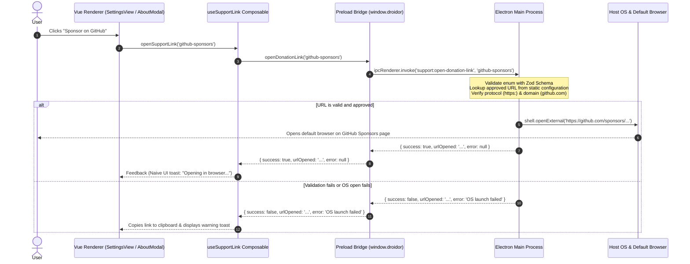

# Feature Specification: Developer Support and Voluntary Contributions ("Donate")

**Target Application:** `droid.or` (Cross-platform Desktop Application for Android Device Management)  
**Document Version:** 1.0.0  
**Status:** Review / Proposal  
**Assessment Date:** October 29, 2026  
**Decision Gate Status:** **CONDITIONAL GO**

---

## 1. Executive Summary

This document provides a comprehensive technical, legal, compliance, and architectural assessment regarding the introduction of a voluntary financial contribution mechanism ("Donate" / "Support Development") into **`droid.or`**.

### Key Architectural Finding

A critical finding of this assessment is that **`droid.or` is an Electron-based desktop application (Node.js, TypeScript, Vue 3, Naive UI)** running on Linux, macOS, and Windows. It connects to external physical Android devices over USB using the Android Debug Bridge (ADB).

**`droid.or` is NOT an Android application (`.apk` / `.aab`) distributed through the Google Play Store.** It contains no Android Manifest, no Gradle build configuration, and no Google Play In-App Billing dependencies. Consequently:

1. **Google Play Developer Distribution Agreement (DDA) and Google Play In-App Billing policies do not govern this application's desktop distribution or in-app payment flows.**
2. Restrictive mobile store anti-steering and mandatory in-app purchase (IAP) commission rules (such as Google Play's 15–30% fee on digital goods) do **not** apply to desktop builds distributed via GitHub Releases, direct download, AppImage, DMG, or NSIS installers.
3. If an Android-native companion app or mobile port were ever planned for Google Play in the future, distinct and severe policy constraints would apply (detailed in Section 5.1).

### Decision Gate: CONDITIONAL GO

The implementation of a voluntary contribution feature is **technically feasible, operationally straightforward, and legally permissible**, subject to the fulfillment of mandatory legal and operational prerequisites:

- **Prerequisite 1 (Licensing):** The repository is currently unlicensed (`"license": "UNLICENSED"`, `private: true`). Prior to public release and soliciting financial contributions, an explicit open-source license (such as MIT or Apache-2.0) or commercial terms must be formally adopted to establish copyright, usage rights, and liability disclaimers.
- **Prerequisite 2 (Patronage vs. Tax-Exempt Status):** The developer/maintainer is an individual or commercial software entity, not a recognized 501(c)(3) or tax-exempt charitable institution. The feature must be explicitly labeled as **"Support Development"**, **"Tip"**, or **"Sponsorship"**, and accompanied by clear disclosures that contributions are **not tax-deductible charitable donations** and **grant no digital perks, feature unlocks, or contractual warranties**.
- **Prerequisite 3 (Zero In-App Financial Data / External Redirection):** The desktop application must not integrate payment processing SDKs, collect cardholder data, or embed secret API keys. Payment processing must occur entirely outside the application via an approved secure browser redirection (`shell.openExternal`) to established creator sponsorship platforms (**GitHub Sponsors**, **Ko-fi**, or **Stripe Payment Links**).

---

## 2. Application Overview

| Dimension                   | Details                                                                                                                                                      |
| :-------------------------- | :----------------------------------------------------------------------------------------------------------------------------------------------------------- |
| **Application Name**        | `droid.or` (`desktopName: droid.or.desktop`, package: `droid-or`)                                                                                            |
| **Current Version**         | `0.1.0`                                                                                                                                                      |
| **Application Type**        | Cross-platform Desktop Utility                                                                                                                               |
| **Runtime Environment**     | Electron 44.2.0, Node.js LTS, Chromium                                                                                                                       |
| **Frontend Framework**      | Vue 3.5, Vite 7.3, Pinia 4.0, Naive UI 2.45, Tailwind CSS v4                                                                                                 |
| **Persistence Layer**       | Local SQLite (`better-sqlite3` 13.0) with sequential migrations                                                                                              |
| **Communication Mechanism** | USB / ADB (`child_process.execFile` with hardcoded `string[]` argv)                                                                                          |
| **Target Platforms**        | Linux (AppImage, verified), Windows (NSIS / portable `.exe`), macOS (`.dmg`, `.zip`)                                                                         |
| **Core Functionality**      | Device inspection, package enumeration, risk-classified debloating, APK/split install, device-to-device app copying, local backup/recovery, live ADB logging |
| **Distribution Channel**    | GitHub Releases / direct downloads (standalone native packages)                                                                                              |

`droid.or` is designed for privacy-conscious Android power users, developers, and technicians. It requires no root privileges on the connected phone and enforces strict process isolation (`contextIsolation: true`, `sandbox: true`, typed Zod IPC validation) to ensure that untrusted renderer code cannot execute arbitrary shell commands.

---

## 3. Scope and Objectives

### In-Scope

- Designing a non-intrusive, compliant UI entry point for voluntary developer contributions within `droid.or` (Settings view and About dialog).
- Selecting and integrating external payment and sponsorship platforms (GitHub Sponsors, Ko-fi, Stripe Payment Links).
- Establishing technical safeguards (IPC validation, strict HTTPS URL domain whitelisting, OS browser launching).
- Drafting transparent user-facing notices, tax disclosures, refund policies, and disclaimer texts.
- Defining automated and manual verification plans.

### Out-of-Scope (Strict Non-Goals)

- Embedding payment processing SDKs (e.g. Stripe SDK, PayPal JavaScript SDK) directly into the Electron main or renderer processes.
- Processing or storing credit card numbers, bank details, or donor personally identifiable information (PII).
- Implementing paywalls, locked features, or donation-gated capabilities.
- Accepting cryptocurrency payments or implementing custodial financial mechanisms.
- Building or hosting a custom payment web server or backend infrastructure.

---

## 4. Repository Analysis

A systematic analysis of the repository was conducted to inspect code architecture, dependencies, licensing, and UI insertion points.

### 4.1 Repository Structure & Relevant Paths

```
droid.or/
├── package.json                          # App metadata, dependencies, scripts, "license": "UNLICENSED"
├── electron-builder.yml                  # Desktop packaging configuration for Linux, Windows, macOS
├── README.md                             # Product documentation and license status
├── SECURITY.md                           # Process isolation, preload bridge, local persistence, network usage
├── CONTRIBUTING.md                       # Coding standards and development guidelines
├── ADB.md                                # Platform ADB guidance and Google platform-tools distribution
├── ANDROID_COMPATIBILITY.md              # Real-device verification records
├── docs/specification.md                 # Full original product specification
├── src/
│   ├── main/
│   │   ├── index.ts                      # BrowserWindow creation, webPreferences, shell.openExternal handler
│   │   ├── adb/                          # AdbClient, platform-tools downloader, zip extractor
│   │   ├── android/                      # Package management, debloat analyzer, AI analysis service
│   │   ├── ipc/                          # IPC channel registration and handlers
│   │   └── persistence/                  # SQLite database, schema migrations, repositories
│   ├── preload/
│   │   └── index.ts                      # contextBridge.exposeInMainWorld('droidor', ...) with Zod validation
│   ├── renderer/src/
│   │   ├── App.vue                       # Root layout and theme injection
│   │   ├── components/layout/AppShell.vue # Top nav bar, header action buttons, device sidebar, footer
│   │   ├── components/ui/PageHeader.vue  # Standardized view header
│   │   ├── components/SafetyDisclaimerModal.vue # First-launch blocking safety acknowledgment
│   │   ├── views/SettingsView.vue        # System settings: ADB connection, Theme, optional AI provider
│   │   └── stores/                       # Pinia stores (settings, devices, packages, operations, logs)
│   └── shared/
│       ├── constants/ipc-channels.ts     # Centralized IpcChannel enum
│       ├── types/droidor-api.ts          # Window.droidor interface contract
│       └── validation/                   # Zod request/response schemas
```

### 4.2 Architectural Assessment of Existing Capabilities

1. **Network Boundary ([`SECURITY.md`](SECURITY.md#L97-L123)):** `droid.or` makes zero background network calls, contains no telemetry, and contacts the network in only two strictly user-initiated scenarios:
   - Downloading official Google `platform-tools` directly from `dl.google.com`.
   - Optional, user-configured AI analysis of single packages sent directly to Anthropic or an OpenAI-compatible endpoint.
2. **External Link Handling ([`src/main/index.ts`](src/main/index.ts#L44-L49)):** The Electron window already traps link requests:
   ```typescript
   mainWindow.webContents.setWindowOpenHandler((details) => {
     void shell.openExternal(details.url)
     return { action: 'deny' }
   })
   ```
   This prevents arbitrary popups or child Electron windows and ensures external links delegate to the host operating system's default browser.
3. **Preload Boundary Integrity ([`src/preload/index.ts`](src/preload/index.ts)):** The renderer process has no Node.js access and cannot call `shell.openExternal` directly. Any new action must pass through an explicit IPC channel registered in `src/shared/constants/ipc-channels.ts` and validated with Zod in `src/shared/validation/`.

### 4.3 Evaluation of UI Integration Points

- **Primary Insertion Point — Settings View ([`src/renderer/src/views/SettingsView.vue`](src/renderer/src/views/SettingsView.vue)):**
  The Settings view currently houses modular configuration cards (`ADB Connection`, `Appearance`, `AI Analysis (optional)`). A dedicated card titled **"Support Development"** fits naturally into this page layout without disrupting operational workflows.
- **Secondary Insertion Point — Application Footer & About Modal ([`src/renderer/src/components/layout/AppShell.vue`](src/renderer/src/components/layout/AppShell.vue#L168-L176)):**
  The footer displays `droid.or v0.1.0 · Electron 44.2.0`. Adding a lightweight "About droid.or" button or subtle "Support" heart icon in the footer allows users to view application credits, open-source acknowledgments, and voluntary sponsorship links.

---

## 5. Legal, Licensing, and Platform-Policy Assessment

### 5.1 Analysis of Google Play and Android Policies

Although `droid.or` is a desktop application not distributed on Google Play, analyzing Google Play policies is essential for risk due diligence and for evaluating hypothetical mobile companion scenarios.

| Policy Domain              | Google Play Rule (Mobile)                                                                                                                                                                                       | Application to `droid.or` (Desktop)                                                                                                                                                                                                                 | Status                  |
| :------------------------- | :-------------------------------------------------------------------------------------------------------------------------------------------------------------------------------------------------------------- | :-------------------------------------------------------------------------------------------------------------------------------------------------------------------------------------------------------------------------------------------------- | :---------------------- |
| **Mandatory Play Billing** | Google Play Developer Policy requires apps offering digital features, content, or services to use Google Play's billing system.                                                                                 | **Not Applicable.** `droid.or` is an Electron desktop binary (x86_64/ARM64) distributed outside Google Play. Google Play policies do not govern Windows, macOS, or Linux desktop applications.                                                      | **COMPLIANT**           |
| **Donations vs. Tips**     | Google Play prohibits calling contributions "donations" unless the developer is a verified tax-exempt charity (e.g. 501(c)(3)). Non-charity peer-to-peer tips are permitted only if 0% digital perks are given. | **Advisory Principle.** While Google Play policies do not apply directly, the underlying principle of consumer transparency _does_ apply under general consumer protection law: non-charities must not solicit funds as "tax-deductible donations." | **ADOPTED AS STANDARD** |
| **Anti-Steering Rules**    | Google Play prohibits directing users to external payment gateways to purchase digital goods.                                                                                                                   | **Not Applicable.** Desktop software is distributed freely without app store exclusivity.                                                                                                                                                           | **COMPLIANT**           |

> [!NOTE]
> **Hypothetical Mobile Companion Port Warning:**  
> If the project ever produces an Android `.apk` companion app (e.g. for wireless ADB pairing or local inspection) and distributes it via Google Play, that companion app **could not** contain external PayPal/Stripe/Ko-fi donation buttons without risking rejection under Google Play's Payments policy, unless the app unlocked no digital goods and adhered strictly to Play Store tip-jar regulations.

### 5.2 Third-Party Terms & Intellectual Property Considerations

1. **Google Android SDK / Platform-Tools (`dl.google.com`):**  
   `droid.or` downloads the official platform-tools archive on-demand from Google's servers. The Android Software Development Kit License Agreement permits downloading and using the tools for development and administration. `droid.or` does not redistribute or re-host the platform-tools archive, ensuring full compliance.
2. **Android Wordmark and Logo Usage:**  
   "Android" is a registered trademark of Google LLC. Google's Brand Guidelines stipulate that third-party applications must not use the Android robot logo or use "Android" in a manner that implies official endorsement. `droid.or` uses a stylized lowercase letter "d" in an emerald squircle ([`build/icon.png`](build/icon.png)) and does not use the Android robot as its application icon. Any donation text must state: _"droid.or is an independent open-source project and is not affiliated with, sponsored by, or endorsed by Google LLC or the Android Open Source Project."_

### 5.3 Open-Source and Dependency Licensing

All nine direct production dependencies of `droid.or` were evaluated:

| Package             | Version  | Declared License | Redistribution & Commercial Impact                      |
| :------------------ | :------- | :--------------- | :------------------------------------------------------ |
| `@vicons/ionicons5` | `0.13.0` | MIT              | Permissive; attribution required in distributed notice. |
| `app-info-parser`   | `1.1.6`  | MIT              | Permissive; permits commercial/non-commercial use.      |
| `better-sqlite3`    | `13.0.3` | MIT              | Permissive; native SQLite bindings.                     |
| `naive-ui`          | `2.45.3` | MIT              | Permissive UI component library.                        |
| `pinia`             | `4.0.3`  | MIT              | Permissive state management.                            |
| `vue`               | `3.5.42` | MIT              | Permissive web framework.                               |
| `vue-router`        | `5.3.1`  | MIT              | Permissive routing library.                             |
| `yauzl`             | `^3.4.0` | MIT              | Permissive zip extraction.                              |
| `zod`               | `4.5.4`  | MIT              | Permissive schema validation.                           |

- **Zero Copyleft / Zero Viral Licenses:** None of the dependencies use GPL, AGPL, or SSPL. There are no copyleft restrictions that mandate relicensing or dictate monetization rules.
- **Current Repository Status:** In [`package.json`](package.json#L10), the repository states `"license": "UNLICENSED"` and `"private": true`. In [`README.md`](README.md#L108-L109), it states: _"Not currently licensed for external distribution or reuse."_  
  **Mandatory Condition:** Before releasing `droid.or` publicly and accepting community financial contributions, the copyright owner must formally add an open-source license file (recommended: **MIT License**) to grant users legal rights to download, run, and inspect the code.

### 5.4 General Legal, Tax, and Financial Regulations

1. **Tax Treatment of Contributions:**  
   Because the maintainer is not an established 501(c)(3) (US) or registered charitable entity, financial contributions are categorized as **taxable personal or business income** (gifts / tips / patronage). They are **not tax-deductible** for contributors. The UI must never claim or imply tax-deductible charitable status.
2. **Consumer Protection & No-Perks Doctrine:**  
   To prevent consumer protection disputes or implied warranty liabilities, contributions must be strictly voluntary and grant no exclusive functional benefits. If donating unlocked a feature, the transaction would be legally classified as a software sale, creating obligations regarding sales tax, VAT (e.g. EU VAT MOSS), refund guarantees, and merchant-of-record compliance.
3. **PCI-DSS and Data Protection (GDPR / CCPA):**  
   By routing all payment interactions to an external browser window hosted by an accredited payment processor (e.g. GitHub/Stripe/PayPal), `droid.or` completely avoids touching credit card numbers, bank accounts, or billing addresses. The application's PCI-DSS compliance scope remains **out-of-scope (Scope Zero)**.

### 5.5 Research and Evidence Citations

| Citation #   | Source Title                       | Organization / URL                                                                                                  | Date Accessed | Policy / Clause Reference                      | Project Impact                                                                                                                     |
| :----------- | :--------------------------------- | :------------------------------------------------------------------------------------------------------------------ | :------------ | :--------------------------------------------- | :--------------------------------------------------------------------------------------------------------------------------------- |
| **[REF-01]** | Google Play Payments Policy        | Google Support ([play.google.com](https://support.google.com/googleplay/android-developer/answer/9858738))          | Oct 2026      | Section: _Alternative Billing & Donations_     | Confirms Play Billing applies only to apps on Google Play. Pure peer-to-peer tips require 0% digital return.                       |
| **[REF-02]** | Android Brand Guidelines           | Android Developers ([developer.android.com/legal](https://developer.android.com/legal))                             | Oct 2026      | Section: _Brand & Trademark Use_               | Requires explicit disclaimer that `droid.or` is not endorsed by Google LLC.                                                        |
| **[REF-03]** | GitHub Sponsors Additional Terms   | GitHub Legal ([docs.github.com](https://docs.github.com/site-policy/github-terms/github-sponsors-additional-terms)) | Oct 2026      | Section: _Sponsorship Eligibility & Fees_      | 0% fee on personal sponsorships; handles developer tax forms (W-8BEN / W-9).                                                       |
| **[REF-04]** | Stripe Payment Links Documentation | Stripe Support ([stripe.com/docs/payment-links](https://stripe.com/docs/payment-links))                             | Oct 2026      | Section: _Customer-chosen amounts / Donate_    | Enables hosted Pay-What-You-Want checkouts without code or backend.                                                                |
| **[REF-05]** | PayPal Acceptable Use Policy       | PayPal Legal ([paypal.com/us/legalhub/acceptableuse-full](https://www.paypal.com/us/legalhub/acceptableuse-full))   | Oct 2026      | Section: _Charities & Nonprofits vs. Personal_ | Strictly prohibits personal accounts from soliciting "donations" without charity verification; requires labeling as personal tips. |

---

## 6. Existing Disclaimer and Privacy Review

An audit of existing notices in `droid.or` was performed to identify gaps before introducing financial support features.

| Notice / Disclaimer Area                | Current Status in Codebase                                                                                                                                                                               | Classification | Deficiencies / Required Action                                                                                   |
| :-------------------------------------- | :------------------------------------------------------------------------------------------------------------------------------------------------------------------------------------------------------- | :------------- | :--------------------------------------------------------------------------------------------------------------- |
| **Pre-Operation Safety Disclaimer**     | Implemented in [`SafetyDisclaimerModal.vue`](src/renderer/src/components/SafetyDisclaimerModal.vue#L13-L60). Explains that modifying system packages carries risk and disclaims liability for data loss. | **Adequate**   | Sufficient for package management. No changes needed.                                                            |
| **AI Privacy Disclosure**               | Implemented in [`SettingsView.vue`](src/renderer/src/views/SettingsView.vue#L274-L290). Explains exact data sent when using the optional "Ask AI" feature.                                               | **Adequate**   | Transparent and scoped. No changes needed.                                                                       |
| **Platform-Tools Download Notice**      | Implemented in [`SettingsView.vue`](src/renderer/src/views/SettingsView.vue#L202-L205). Explains platform-tools are fetched from Google servers (`dl.google.com`).                                       | **Adequate**   | Clearly discloses upstream origin.                                                                               |
| **Project License Notice**              | Missing. Declared as `"UNLICENSED"` in `package.json` and `README.md`.                                                                                                                                   | **Missing**    | Must add an official open-source license (recommended: `LICENSE` containing the MIT License) prior to release.   |
| **Third-Party Trademark Disclaimer**    | Incomplete. Mentioned informally in documentation, but absent in application UI.                                                                                                                         | **Incomplete** | Must add trademark disclaimer clarifying non-affiliation with Google LLC, Android, Samsung, etc.                 |
| **Voluntary Contribution & Tax Notice** | Absent. No existing donation functionality or legal text.                                                                                                                                                | **Missing**    | Must implement clear disclaimer that contributions are non-deductible personal gifts granting zero in-app perks. |

### Proposed Disclaimer Text for Support & Contribution UI

The following text must be incorporated directly into the contribution UI:

> **Support Voluntary Development**  
> `droid.or` is an independent open-source tool developed and maintained for the Android community. Contributions are entirely voluntary and help cover hardware testing costs, hosting, and ongoing development time.
>
> - **No Feature Unlocks:** All features of `droid.or` are 100% free and open to everyone; contributions do not grant premium perks, licenses, or special privileges.
> - **Not Tax-Deductible:** Contributions support an independent developer and do not qualify as tax-deductible charitable donations under applicable tax laws.
> - **Trademark Notice:** Android, Google Play, and ADB are trademarks of Google LLC. `droid.or` is an independent project and is not affiliated with, sponsored by, or endorsed by Google LLC or device manufacturers.

---

## 7. Donation Provider Comparison

Five potential contribution mechanisms were evaluated against the technical, operational, and legal realities of `droid.or`:

| Evaluation Criteria               | GitHub Sponsors                      | Ko-fi                                 | Stripe Payment Links           | PayPal Direct Button                                                  | Platform IAP (Play/Microsoft)        |
| :-------------------------------- | :----------------------------------- | :------------------------------------ | :----------------------------- | :-------------------------------------------------------------------- | :----------------------------------- |
| **Target Audience**               | Open-source developers, GitHub users | Broad consumer & open-source audience | General public, cardholders    | General consumer base                                                 | App store consumers                  |
| **Integration Complexity**        | **Very Low** (External URL)          | **Very Low** (External URL)           | **Low** (Hosted URL)           | Medium (Web redirect / IPN)                                           | **Prohibitive** (Full SDK + backend) |
| **Platform Fee**                  | **0%** for individuals               | **0%** on one-time tips               | 0% platform fee                | 0% platform fee                                                       | 15% – 30% cut                        |
| **Payment Processing Fee**        | Absorbed by GitHub (personal)        | Standard Stripe/PayPal (2.9% + $0.30) | Standard Stripe (2.9% + $0.30) | Standard PayPal (2.99% + $0.49)                                       | Included in store cut                |
| **One-Time Contributions**        | Supported                            | Supported                             | Supported (Pay What You Want)  | Supported                                                             | Supported (consumable)               |
| **Recurring Sponsorship**         | Supported                            | Supported                             | Supported                      | Supported                                                             | Supported (subscriptions)            |
| **Charity Status Required?**      | **No** (Individual creator mode)     | **No** (Individual tip jar)           | **No** (Standard merchant)     | **Yes** (for "Donate" button; personal tips face account freeze risk) | Strict rules                         |
| **Tax Reporting (Form 1099/W-8)** | Handled by Stripe Connect / GitHub   | User/Stripe responsibility            | User responsibility            | User responsibility                                                   | Store responsibility                 |
| **Data Privacy for User**         | Managed by GitHub                    | Managed by Ko-fi/Stripe               | Managed by Stripe              | Exposes donor name/email                                              | Managed by Store                     |
| **Application Backend Needed?**   | **None**                             | **None**                              | **None**                       | None (basic link)                                                     | Complex backend required             |
| **Recommendation Grade**          | **Preferred (Primary)**              | **Preferred (Secondary)**             | **Viable Alternative**         | **Discouraged**                                                       | **Rejected**                         |

### Critical Provider Insights

1. **GitHub Sponsors (Top Pick for Developers):**
   GitHub Sponsors is the gold standard for developer utilities. GitHub absorbs transaction fees for individual developers and provides automated tax reporting (W-8BEN / W-9 via Stripe Connect). Contributors who already have a GitHub account can sponsor in two clicks.
2. **Ko-fi (Top Pick for General Users):**
   Many everyday Android users do not have a GitHub account. Ko-fi allows non-developers to contribute via Apple Pay, Google Pay, credit cards, or PayPal with 0% platform fees on one-time tips.
3. **PayPal Direct (Avoid for Direct App Integration):**
   PayPal automated compliance algorithms frequently freeze personal accounts that receive repeated international transactions labeled "donation" without 501(c)(3) documentation. Using Ko-fi or Stripe as the intermediary front-end completely mitigates this account-freeze risk.

---

## 8. Recommended Solution and Rationale

### 8.1 The Multi-Channel External Redirection Model

We recommend implementing an **External Multi-Channel Sponsorship Model** featuring:

1. **GitHub Sponsors** as the primary option for developers and technical users.
2. **Ko-fi** (or a **Stripe Payment Link**) as the secondary option for non-technical users desiring Apple Pay, Google Pay, or card checkout.

```
┌────────────────────────────────────────────────────────────────────────┐
│                        Electron Main Process                          │
│                                                                        │
│   ┌──────────────────────────────────────────────────────────────┐    │
│   │                 openDonationLink(providerId)                │    │
│   │   1. Validate providerId ('github-sponsors' | 'kofi')        │    │
│   │   2. Resolve verified URL from hardcoded configuration       │    │
│   │   3. Validate URL protocol (https:) and domain whitelist    │    │
│   │   4. Execute: shell.openExternal(trustedUrl)                 │    │
│   └──────────────────────────────┬───────────────────────────────┘    │
└──────────────────────────────────┼────────────────────────────────────┘
                                   │ IPC (IpcChannel.OpenDonationLink)
┌──────────────────────────────────┴────────────────────────────────────┐
│                    Preload Bridge (window.droidor)                    │
│                                                                        │
│   - Typed method: openDonationLink(provider: DonationProviderId)      │
│   - Validates response with Zod                                        │
└──────────────────────────────────┬────────────────────────────────────┘
                                   │ contextBridge
┌──────────────────────────────────┴────────────────────────────────────┐
│                         Vue 3 Renderer Process                        │
│                                                                        │
│   ┌─────────────────────────────────┐ ┌───────────────────────────┐   │
│   │      SettingsView.vue           │ │      AboutModal.vue       │   │
│   │   "Support Development" Card    │ │  Application info & links │   │
│   └─────────────────────────────────┘ └───────────────────────────┘   │
└───────────────────────────────────────────────────────────────────────┘
                                   │
                                   ▼ (OS Level)
                      Default System Web Browser
                (GitHub Sponsors / Ko-fi Hosted Checkout)
```

### 8.2 Ponytail Assessment: Radical Simplicity & Zero Bloat

In accordance with the **Ponytail** engineering philosophy (*lazy senior developer mode: the smallest complete change that solves the entire problem, zero fluff, and YAGNI*), the architecture deliberately rejects over-engineering:

1. **Zero Database Bloat (No SQLite Tables or Migrations):**  
   Voluntary sponsorships in an open-source utility require no transaction logs, donor badges, or subscription states stored on the user's disk. Creating a `donations` table or migration would add schema maintenance and risk persisting financial metadata for zero user benefit.
2. **Zero Backend & Payment SDK Dependencies:**  
   Zero npm packages are added (`package.json` dependencies remain untouched). No Stripe, PayPal, or crypto client SDKs run in the application. Handing off directly to `shell.openExternal` leaves 100% of payment processing, fraud prevention, and PCI-DSS compliance to the external browser.
3. **Zero Redundant IPC Surface (No Dynamic `GetSupportInfo` Query):**  
   Provider labels, descriptions, and disclaimers are static application text. Serializing marketing strings across IPC from the main process adds ~40 lines of boilerplate and unnecessary test surface. The renderer embeds static UI copy directly, and IPC is reserved strictly for the security boundary: requesting the main process to open a vetted provider link.
4. **Zero State Bloat (No Dedicated Pinia Store):**  
   Triggering an external URL is a stateless action. A heavy Pinia store adds boilerplate files, actions, and getters. Instead, a lightweight ~25-line composable (`useSupportLink.ts`) or direct component call using Naive UI's `useMessage` provides debounced loading, user feedback toasts, and clipboard fallback.
5. **Direct Pattern Reuse:**  
   Reuses existing Naive UI components (`NCard`, `NButton`, `NModal`, `NIcon`, `useMessage`), existing Ionicons, and the proven IPC validation pattern established in `src/preload/index.ts`.

### Why This Approach Is Optimal

- **Zero Security Attack Surface:** The application collects zero payment credentials, requires no external HTTP communication from the Electron runtime, and maintains an attack surface of zero.
- **Zero Infrastructure & Maintenance Overhead:** Requires no servers, webhooks, databases, or payment gateways.
- **100% Policy Compliant:** Free of any app store conflicts, completely transparent, and adheres to consumer protection and anti-steering standards.
- **User Trust:** Users complete contributions on trusted, battle-tested payment pages (GitHub or Ko-fi) with their existing secure payment credentials, rather than entering card numbers into an untrusted desktop utility.

---

## 9. Functional Requirements

- **FR-01: Dedicated Settings Section:** The Settings view must include a distinct card titled "Support Development".
- **FR-02: About Dialog Entry Point:** An "About droid.or" dialog must be accessible from the application footer, containing application version details, open-source attribution, and a "Support Development" action.
- **FR-03: Provider Selection:** The UI must present clear, distinct options for supported contribution channels (e.g., "Sponsor on GitHub" and "Support via Ko-fi").
- **FR-04: Mandatory Transparency Notice:** The contribution interface must explicitly state that contributions are voluntary, do not unlock extra features, and are not tax-deductible.
- **FR-05: External Browser Launch:** Clicking a provider button must request the main process to open the exact configured destination in the user's default system browser.
- **FR-06: Pre-Navigation Confirmation:** If configured, the app must present a brief modal confirming: _"You will be redirected to [Provider Name] in your system web browser."_
- **FR-07: Error Handling & Feedback:** If the operating system cannot launch a browser or the link fails to open, a non-intrusive warning notification must appear informing the user and providing a manual copy-to-clipboard option.
- **FR-08: Zero Functional Blocking:** The application must never nag, lock features, delay startup, or interrupt ADB device operations with donation requests.

---

## 10. Nonfunctional Requirements

- **NFR-01 (Security & URL Whitelisting):** The Electron main process must strictly validate external URLs against a hardcoded whitelist of approved HTTPS domains (`github.com`, `ko-fi.com`, `buy.stripe.com`). Arbitrary user- or renderer-provided URLs must be rejected.
- **NFR-02 (Privacy & Zero Telemetry):** The application must not transmit hardware serials, device IDs, IP addresses, or user identifiers to the donation provider.
- **NFR-03 (Process Isolation):** All external link execution must occur in the main process via `shell.openExternal`. The renderer process must remain sandboxed with no access to Node.js `child_process` or `shell`.
- **NFR-04 (Accessibility - WCAG 2.1 AA):** All support buttons, icons, and dialogs must have proper ARIA attributes, visible focus indicators, and support full keyboard navigation.
- **NFR-05 (Performance & Footprint):** Adding the feature must not add third-party SDK dependencies or increase the bundled application binary size by more than 20 KB.

---

## 11. User Experience and User Flows

### 11.1 Wireframe Mockups

#### Settings View: "Support Development" Card

```
┌────────────────────────────────────────────────────────────────────────┐
│ Support Development                                                    │
│                                                                        │
│ droid.or is a free and open-source project. If you find it useful,     │
│ you can support ongoing maintenance, device testing, and development. │
│                                                                        │
│ ℹ Contributions are voluntary personal gifts, do not unlock additional│
│   features, and are not tax-deductible charitable donations.           │
│                                                                        │
│ [ ❤ Sponsor on GitHub ]    [ ☕ Support on Ko-fi ]                     │
└────────────────────────────────────────────────────────────────────────┘
```

#### About & Support Modal (Footer Trigger)

```
┌────────────────────────────────────────────────────────────────────────┐
│ About droid.or                                                   [ X ] │
├────────────────────────────────────────────────────────────────────────┤
│                                                                        │
│   [ d ]  droid.or v0.1.0                                               │
│          Electron 44.2.0 · Node 26.5.0 · Chromium 132                 │
│                                                                        │
│   An open-source desktop utility for managing and debloating           │
│   non-rooted Android devices over USB.                                 │
│                                                                        │
│   Licensed under the MIT License.                                      │
│   Android is a trademark of Google LLC. Not affiliated with Google.    │
│                                                                        │
│   ──────────────────────────────────────────────────────────────────   │
│   Support the Project:                                                 │
│   Voluntary contributions help fund physical test hardware and ongoing │
│   development. Contributions do not unlock restricted features.        │
│                                                                        │
│   [ Sponsor on GitHub ]    [ Support on Ko-fi ]    [ Close ]           │
│                                                                        │
└────────────────────────────────────────────────────────────────────────┘
```

### 11.2 Sequence Diagram: Donation Flow



---

## 12. Architecture and Component Design

### 12.1 Shared Layer Contracts

#### 1. Constants ([`src/shared/constants/ipc-channels.ts`](src/shared/constants/ipc-channels.ts))

Add the single dedicated IPC channel:

```typescript
export enum IpcChannel {
  // ... existing channels
  OpenDonationLink = 'support:open-donation-link'
}
```

#### 2. Validation Schemas ([`src/shared/validation/support.schema.ts`](src/shared/validation/support.schema.ts) — New File)

Minimal Zod schema covering the allowed providers and return contract:

```typescript
import { z } from 'zod'

export const donationProviderIdSchema = z.enum(['github-sponsors', 'kofi'])
export type DonationProviderId = z.infer<typeof donationProviderIdSchema>

export const openDonationLinkResultSchema = z.object({
  success: z.boolean(),
  urlOpened: z.string().url().nullable(),
  error: z.string().nullable()
})
export type OpenDonationLinkResult = z.infer<typeof openDonationLinkResultSchema>
```

#### 3. Preload API Contract ([`src/shared/types/droidor-api.ts`](src/shared/types/droidor-api.ts))

```typescript
export interface DroidorApi {
  // ... existing methods
  openDonationLink: (provider: DonationProviderId) => Promise<OpenDonationLinkResult>
}
```

### 12.2 Main Process Implementation

#### 1. Static Configuration & Safe Domain Validator ([`src/main/support/support-config.ts`](src/main/support/support-config.ts) — New File)

```typescript
import type { DonationProviderId } from '@shared/validation/support.schema'

export const DONATION_URLS: Record<DonationProviderId, string> = {
  'github-sponsors': 'https://github.com/sponsors/droid-or',
  kofi: 'https://ko-fi.com/droid_or'
}

const ALLOWED_DOMAINS = new Set(['github.com', 'ko-fi.com'])

export function validateSafeExternalUrl(rawUrl: string): boolean {
  try {
    const parsed = new URL(rawUrl)
    return parsed.protocol === 'https:' && ALLOWED_DOMAINS.has(parsed.hostname.toLowerCase())
  } catch {
    return false
  }
}
```

#### 2. IPC Handler ([`src/main/ipc/handlers/support.handler.ts`](src/main/ipc/handlers/support.handler.ts) — New File)

```typescript
import { ipcMain, shell } from 'electron'
import { IpcChannel } from '@shared/constants/ipc-channels'
import {
  donationProviderIdSchema,
  type OpenDonationLinkResult
} from '@shared/validation/support.schema'
import { DONATION_URLS, validateSafeExternalUrl } from '../../support/support-config'

export function registerSupportHandlers(): void {
  ipcMain.handle(
    IpcChannel.OpenDonationLink,
    async (_event, rawProvider: unknown): Promise<OpenDonationLinkResult> => {
      const parsed = donationProviderIdSchema.safeParse(rawProvider)
      if (!parsed.success) {
        return {
          success: false,
          urlOpened: null,
          error: `Invalid donation provider: ${String(rawProvider)}`
        }
      }

      const url = DONATION_URLS[parsed.data]
      if (!url || !validateSafeExternalUrl(url)) {
        return {
          success: false,
          urlOpened: null,
          error: 'The requested donation URL failed security validation.'
        }
      }

      try {
        await shell.openExternal(url)
        return { success: true, urlOpened: url, error: null }
      } catch (err) {
        return {
          success: false,
          urlOpened: url,
          error: err instanceof Error ? err.message : 'Failed to launch default browser.'
        }
      }
    }
  )
}
```

### 12.3 Renderer Layer Implementation (Ponytail Composable)

#### Composable: [`src/renderer/src/composables/useSupportLink.ts`](src/renderer/src/composables/useSupportLink.ts) (New File)

A lightweight ~30-line composable avoiding any Pinia store bloat:

```typescript
import type { DonationProviderId } from '@shared/validation/support.schema'
import { useMessage } from 'naive-ui'
import { ref } from 'vue'

export function useSupportLink() {
  const message = useMessage()
  const opening = ref(false)

  async function openSupportLink(provider: DonationProviderId): Promise<void> {
    if (opening.value) return
    opening.value = true
    try {
      const res = await window.droidor.openDonationLink(provider)
      if (res.success) {
        message.info('Opening link in your browser...')
      } else {
        message.warning(res.error ?? 'Could not open browser. Link copied to clipboard.')
        if (res.urlOpened) {
          await navigator.clipboard.writeText(res.urlOpened)
        }
      }
    } catch {
      message.error('Failed to open donation link.')
    } finally {
      setTimeout(() => {
        opening.value = false
      }, 1000)
    }
  }

  return { opening, openSupportLink }
}
```

---

## 13. Detailed Implementation Plan

The implementation is executed as a series of small, atomic, non-breaking steps following droid.or's architectural patterns and Ponytail principles.

### Phase 1: Legal, Documentation & Licensing Foundations (TSK-01 – TSK-03)
- Establish the open-source license (`LICENSE` MIT file).
- Update `package.json` license metadata.
- Document third-party trademark disclaimers (Google LLC, Android) in `README.md` and `SECURITY.md`.

### Phase 2: Shared Contracts & Preload Boundary (TSK-04 – TSK-08)
- Declare `IpcChannel.OpenDonationLink`.
- Implement Zod validation schema and schema unit tests.
- Extend `DroidorApi` interface and wire the preload bridge with schema validation.

### Phase 3: Main Process Security & Handlers (TSK-09 – TSK-13)
- Implement static URLs and `validateSafeExternalUrl` with unit tests.
- Implement `registerSupportHandlers()` with `shell.openExternal`.
- Wire handler into `register-ipc-handlers.ts` and test IPC handler logic.

### Phase 4: Renderer UI & Composables (TSK-14 – TSK-18)
- Create `useSupportLink` composable with feedback toasts and clipboard fallback.
- Add "Support Development" card to `SettingsView.vue`.
- Build `AboutModal.vue` with app info, license notice, and support buttons.
- Connect modal trigger to the footer version text in `AppShell.vue`.
- Add composable unit tests.

### Phase 5: Verification & Quality Assurance (TSK-19)
- Run full typecheck (`node`, `web`, `test`), linter, formatter, and entire test suite.

---

## 14. Configuration and Environment Setup

### Production vs. Development Configuration

Donation URLs must be configurable without modifying code, while maintaining strict domain validation:

```typescript
// src/main/support/support-config.ts
export function resolveDonationUrl(providerId: DonationProviderId): string {
  // Support local development / staging override via environment variables
  if (process.env.NODE_ENV !== 'production') {
    const envOverride =
      process.env[`DROIDOR_DONATE_URL_${providerId.toUpperCase().replace(/-/g, '_')}`]
    if (envOverride && validateSafeExternalUrl(envOverride)) {
      return envOverride
    }
  }
  return APPROVED_DONATION_PROVIDERS[providerId].url
}
```

- **No Build Secrets:** No API keys, secret tokens, or webhook secrets are required.
- **Publish-Time Validation:** CI build workflows verify that the configured destination URLs return HTTP 200/302 responses before generating release packages.

---

## 15. Security and Privacy Considerations

1. **Defense Against Arbitrary URL Injection:**
   The renderer process never passes an arbitrary URL string to the main process. It only passes a validated enum (`'github-sponsors'` or `'kofi'`). The main process looks up the URL from an immutable internal table and re-validates the domain whitelist before invoking `shell.openExternal`.
2. **Preventing Malicious Protocol Exploitation:**
   Only the `https:` protocol is allowed. Protocols such as `file:`, `javascript:`, `data:`, or custom deep-link schemes (`intent:`, `tg:`) are rejected by `validateSafeExternalUrl`, preventing remote code execution or local file access vulnerabilities.
3. **No Embedded WebViews:**
   The payment page is **never** loaded inside an Electron `<webview>` tag, `BrowserView`, or iframe. Embedded webviews in desktop applications increase XSS risk, can intercept session cookies, and trigger anti-fraud blocks from PayPal and Stripe. Handing off to the OS default browser isolates all financial transactions.
4. **Data Minimization:**
   Zero telemetry is collected. The desktop application does not log when a user clicks the support button and does not record donation amounts or donor names in the local SQLite database.

---

## 16. Error Handling

| Failure Scenario                  | Technical Root Cause                             | User Experience / UI Behavior                                                                                                                                           |
| :-------------------------------- | :----------------------------------------------- | :---------------------------------------------------------------------------------------------------------------------------------------------------------------------- |
| **No Default Browser Configured** | `shell.openExternal` rejects with OS error code. | Displays a Naive UI warning notification: _"Could not launch system browser."_ Surfaces a "Copy Link" button allowing the user to copy the URL manually.                |
| **Offline Device / No Internet**  | Host computer has no internet connection.        | Browser will open and display standard browser offline page. The app displays an informational toast reminding the user that an active internet connection is required. |
| **Invalid URL or Protocol**       | Configuration corrupted or tampered with.        | Request rejected at Zod / main validator. An error toast is shown: _"Invalid contribution destination."_ Error is logged to main process debug log.                     |
| **Double-Click / Rapid Clicking** | User repeatedly clicks support button.           | Button enters a 1-second debounced/loading state to prevent spawning multiple browser tabs.                                                                             |

---

## 17. Testing Strategy

### 17.1 Automated Unit & Integration Tests (Vitest)

- **Schema Validation Tests (`tests/shared/support.schema.test.ts`):**
  - Verify `donationProviderIdSchema` accepts `'github-sponsors'` and `'kofi'`.
  - Verify rejection of unknown strings, empty values, or malicious payloads.
  - Verify `openDonationLinkResultSchema` enforces expected boolean and nullable fields.
- **URL Validator Tests (`tests/main/support/support-config.test.ts`):**
  - Verify that legitimate HTTPS URLs for `github.com` and `ko-fi.com` return `true`.
  - Verify that `http:`, `file:`, `javascript:`, and subdomains of unapproved sites return `false`.
  - Verify that malformed URLs or empty strings return `false` without throwing uncaught exceptions.
- **IPC Handler Tests (`tests/main/ipc/support.handler.test.ts`):**
  - Stub `shell.openExternal` using Vitest spies (`vi.spyOn`).
  - Test valid provider ID triggers `shell.openExternal` with the exact mapped URL.
  - Test invalid provider ID returns `{ success: false, error: ... }` without crashing main process.
  - Test OS launch failure is caught gracefully and returns `{ success: false, error: ... }`.
- **Renderer Composable Tests (`tests/renderer/composables/useSupportLink.test.ts`):**
  - Stub `window.droidor.openDonationLink` and `navigator.clipboard.writeText`.
  - Verify `opening` debounce state transitions.
  - Verify info toast on success and warning toast + clipboard copy fallback on failure.

### 17.2 Manual QA & Platform Verification Matrix

- **Linux (Ubuntu / Debian / Fedora):** Verify that `xdg-open` correctly opens the system default browser (Firefox/Chrome) when clicking the support button from an AppImage build.
- **Windows 11:** Verify that default browser (Edge/Chrome) launches smoothly from an installed or portable build without triggering UAC warnings.
- **macOS (Sonoma / Sequoia):** Verify that Safari/Chrome launches from an unnotarized DMG build without Gatekeeper interference.
- **Keyboard Navigation & Screen Reader:** Verify that `Tab` navigation reaches all support buttons and screen readers announce button labels and disclaimer texts.

---

## 18. Acceptance Criteria

- [ ] **AC-01 (Licensing):** An official `LICENSE` file containing the MIT License is committed to the repository root, and `package.json` reflects `"license": "MIT"`.
- [ ] **AC-02 (Settings Entry Point):** A "Support Development" card is visible on `SettingsView.vue` with functioning buttons for GitHub Sponsors and Ko-fi.
- [ ] **AC-03 (About Modal Entry Point):** Clicking the version text in the footer opens an "About droid.or" modal displaying app version, license, trademark disclaimers, and support links.
- [ ] **AC-04 (Safe Redirection):** Clicking a support button opens the exact approved HTTPS URL in the host operating system's default browser.
- [ ] **AC-05 (Strict Validation):** The main process rejects any unapproved provider or invalid URL protocol, logging a sanitized error.
- [ ] **AC-06 (Mandatory Disclaimers):** Disclaimers stating that contributions are voluntary, non-deductible, and grant no special perks are prominently displayed on all support surfaces.
- [ ] **AC-07 (Copy Link Fallback):** If browser launching fails, the UI provides a one-click button to copy the contribution URL to the clipboard.
- [ ] **AC-08 (Zero Functional Regressions):** Core ADB functionality (device connection, package debloating, APK installation) remains 100% unaffected.
- [ ] **AC-09 (Test Coverage):** All newly added unit and store tests pass cleanly, and total test suite execution remains 100% green.

---

## 19. Risks, Assumptions, and Dependencies

### Risk Assessment Matrix

| Risk ID    | Category             | Description                                                                                                            | Likelihood | Impact   | Mitigation Strategy                                                                                                          | Block Release?           |
| :--------- | :------------------- | :--------------------------------------------------------------------------------------------------------------------- | :--------- | :------- | :--------------------------------------------------------------------------------------------------------------------------- | :----------------------- |
| **RSK-01** | **Legal**            | The repository remains unlicensed (`"UNLICENSED"`), leaving intellectual property and liability disclaimers ambiguous. | High       | High     | Formally commit an open-source `LICENSE` (MIT) before public release.                                                        | **YES (Prerequisite)**   |
| **RSK-02** | **Tax / Regulatory** | Contributions are misconstrued as tax-deductible donations, leading to donor disputes or tax agency scrutiny.          | Medium     | Medium   | Mandate explicit UI wording stating that contributions are personal gifts / sponsorships and not tax-deductible.             | **YES (Prerequisite)**   |
| **RSK-03** | **Security**         | Malicious renderer code exploits open-url IPC to launch arbitrary websites or local scripts.                           | Low        | Critical | Main-process Zod enum validation and hardcoded HTTPS domain whitelist; reject any URL supplied by renderer.                  | **YES (Must implement)** |
| **RSK-04** | **Payment Account**  | Provider flags personal account for receiving unauthorized donations.                                                  | Medium     | Medium   | Direct users to GitHub Sponsors and Ko-fi creator tip jars, which are explicitly built for independent software maintainers. | No                       |
| **RSK-05** | **Trademark**        | Google or OEM objects to software branding or donation messaging.                                                      | Low        | Low      | Display prominent disclaimer that `droid.or` is an independent utility not affiliated with or endorsed by Google LLC.        | No                       |

---

## 20. Implementation Task Breakdown

### 20.1 Task Status Protocol & Ponytail Workflow

All work on this feature follows the **Ponytail** engineering discipline (*lazy senior developer mode: the smallest complete change that solves the entire problem, zero fluff, and YAGNI*).

To allow work to pause, resume, and switch between agents or context windows seamlessly without losing state:
- Each atomic task is assigned a state mark:
  - `[TODO]` — Not yet started.
  - `[INPROGRESS]` — Currently being implemented. Only one task should be `[INPROGRESS]` at a time.
  - `[DONE]` — Implemented, verified with its exact verification command, and confirmed passing.
- **Resumption Protocol:** When resuming work in a new session or after a context compaction, look for the first non-`[DONE]` task in the **Task Status Board** below and continue from that exact task.
- **Completion Protocol:** Before updating a task from `[INPROGRESS]` to `[DONE]`, run the task's designated **Verification Command**. If the command fails, the task remains `[INPROGRESS]`.
- **Zero Bloat Enforcement:** Every task touches the smallest possible set of files (typically 1–2 files), avoids unnecessary abstractions or wrappers, and leaves clean, working tests.

---

### 20.2 Task Status Board

| Status | Task ID | Phase | Title | Primary File(s) | Dependencies |
| :---: | :--- | :--- | :--- | :--- | :--- |
| `[DONE]` | **TSK-01** | Phase 1 | Create Root `LICENSE` File (MIT) | `LICENSE` | None |
| `[DONE]` | **TSK-02** | Phase 1 | Update `package.json` License Metadata | `package.json` | TSK-01 |
| `[DONE]` | **TSK-03** | Phase 1 | Update Documentation & Trademark Disclaimers | `README.md`, `SECURITY.md` | TSK-02 |
| `[TODO]` | **TSK-03B** | Phase 1 | Ignore `.agents` in `.prettierignore` (Bug Fix) | `.prettierignore` | None |
| `[TODO]` | **TSK-04** | Phase 2 | Declare `OpenDonationLink` in `IpcChannel` | `src/shared/constants/ipc-channels.ts` | None |
| `[TODO]` | **TSK-05** | Phase 2 | Define Zod Validation Schema for Support Links | `src/shared/validation/support.schema.ts` | None |
| `[TODO]` | **TSK-06** | Phase 2 | Add Unit Tests for Support Schemas | `tests/shared/support.schema.test.ts` | TSK-05 |
| `[TODO]` | **TSK-07** | Phase 2 | Extend `DroidorApi` Interface Contract | `src/shared/types/droidor-api.ts` | TSK-05 |
| `[TODO]` | **TSK-08** | Phase 2 | Wire Preload Bridge with Zod Schema Validation | `src/preload/index.ts` | TSK-04, TSK-05, TSK-07 |
| `[TODO]` | **TSK-09** | Phase 3 | Implement Static URLs & Safe Domain Validator | `src/main/support/support-config.ts` | TSK-05 |
| `[TODO]` | **TSK-10** | Phase 3 | Add Unit Tests for URL Validator & Config | `tests/main/support/support-config.test.ts` | TSK-09 |
| `[TODO]` | **TSK-11** | Phase 3 | Implement Main IPC Handler (`shell.openExternal`) | `src/main/ipc/handlers/support.handler.ts` | TSK-04, TSK-05, TSK-09 |
| `[TODO]` | **TSK-12** | Phase 3 | Register Support Handler in Main IPC Registry | `src/main/ipc/register-ipc-handlers.ts` | TSK-11 |
| `[TODO]` | **TSK-13** | Phase 3 | Add Unit Tests for Support IPC Handler | `tests/main/ipc/support.handler.test.ts` | TSK-11, TSK-12 |
| `[TODO]` | **TSK-14** | Phase 4 | Implement `useSupportLink` Composable | `src/renderer/src/composables/useSupportLink.ts` | TSK-07, TSK-08 |
| `[TODO]` | **TSK-15** | Phase 4 | Add "Support Development" Card to Settings View | `src/renderer/src/views/SettingsView.vue` | TSK-14 |
| `[TODO]` | **TSK-16** | Phase 4 | Build `AboutModal.vue` Component | `src/renderer/src/components/AboutModal.vue` | TSK-14 |
| `[TODO]` | **TSK-17** | Phase 4 | Wire About Modal into `AppShell.vue` Footer | `src/renderer/src/components/layout/AppShell.vue` | TSK-16 |
| `[TODO]` | **TSK-18** | Phase 4 | Add Unit Tests for `useSupportLink` Composable | `tests/renderer/composables/useSupportLink.test.ts` | TSK-14 |
| `[TODO]` | **TSK-19** | Phase 5 | Execute Full Quality Gate & Regressions Check | Global repository | TSK-01 – TSK-18 |

---

### 20.3 Atomic Task Specifications

#### Phase 1: Legal & Licensing Foundations

##### [DONE] TSK-01: Create Root `LICENSE` File (MIT)
- **Status:** `[DONE]`
- **Target Files:** `LICENSE` (New file)
- **Description:** Add the standard MIT License to the repository root. Set copyright year to 2026 and attribution to `droid.or maintainers & contributors`.
- **Ponytail Check:** Standard MIT text; zero custom legal wording or non-standard riders.
- **Verification Command:** `test -f LICENSE && grep -q "MIT License" LICENSE`
- **Dependencies:** None

##### [DONE] TSK-02: Update `package.json` License Metadata
- **Status:** `[DONE]`
- **Target Files:** `package.json`
- **Description:** Change `"license": "UNLICENSED"` to `"license": "MIT"`. Keep `"private": true` until public release.
- **Ponytail Check:** Exactly 1 line changed in `package.json`.
- **Verification Command:** `node -e 'const pkg = JSON.parse(require("fs").readFileSync("package.json")); if (pkg.license !== "MIT") process.exit(1);'`
- **Dependencies:** TSK-01

##### [DONE] TSK-03: Update Documentation & Trademark Disclaimers
- **Status:** `[DONE]`
- **Target Files:** `README.md`, `SECURITY.md`
- **Description:** Replace "Not currently licensed for external distribution" in `README.md` with explicit reference to `LICENSE`. Add the standard Google LLC and Android trademark disclaimer to `README.md` and `SECURITY.md`.
- **Ponytail Check:** Surgical documentation updates touching only the license and legal disclaimer sections.
- **Verification Command:** `git diff README.md SECURITY.md`
- **Dependencies:** TSK-02

##### [TODO] TSK-03B: Ignore `.agents` in `.prettierignore` (Bug Fix)
- **Status:** `[TODO]`
- **Target Files:** `.prettierignore`
- **Description:** Exclude `.agents` directory in `.prettierignore` so local agent skill files do not trigger workspace Prettier formatting failures.
- **Ponytail Check:** Exactly 1 line added to `.prettierignore`.
- **Verification Command:** `npm run format:check`
- **Dependencies:** None

---

#### Phase 2: Shared Contracts & Preload Boundary

##### [TODO] TSK-04: Declare `OpenDonationLink` in `IpcChannel` Enum
- **Status:** `[TODO]`
- **Target Files:** `src/shared/constants/ipc-channels.ts`
- **Description:** Add `OpenDonationLink = 'support:open-donation-link'` to the `IpcChannel` enum.
- **Ponytail Check:** Exactly 1 enum member added. No redundant channels.
- **Verification Command:** `npm run typecheck:node`
- **Dependencies:** None

##### [TODO] TSK-05: Define Zod Validation Schema for Support Links
- **Status:** `[TODO]`
- **Target Files:** `src/shared/validation/support.schema.ts` (New file)
- **Description:** Export `donationProviderIdSchema = z.enum(['github-sponsors', 'kofi'])`, its inferred type `DonationProviderId`, and `openDonationLinkResultSchema`.
- **Ponytail Check:** Under 20 lines of code. No dynamic metadata schemas; covers only the runtime IPC payload.
- **Verification Command:** `npm run typecheck:node`
- **Dependencies:** None

##### [TODO] TSK-06: Add Unit Tests for Support Schemas
- **Status:** `[TODO]`
- **Target Files:** `tests/shared/support.schema.test.ts` (New file)
- **Description:** Verify valid provider IDs (`github-sponsors`, `kofi`) pass; invalid IDs (`paypal`, `unknown`, `""`) fail; result schema parses expected fields.
- **Ponytail Check:** Direct assert-based Vitest unit test following existing schema test conventions (`tests/shared/app-info.schema.test.ts`).
- **Verification Command:** `npx vitest run tests/shared/support.schema.test.ts`
- **Dependencies:** TSK-05

##### [TODO] TSK-07: Extend `DroidorApi` Interface Contract
- **Status:** `[TODO]`
- **Target Files:** `src/shared/types/droidor-api.ts`
- **Description:** Add `openDonationLink: (provider: DonationProviderId) => Promise<OpenDonationLinkResult>` to the `DroidorApi` interface.
- **Ponytail Check:** Exactly 1 typed method signature added to the interface.
- **Verification Command:** `npm run typecheck:web`
- **Dependencies:** TSK-05

##### [TODO] TSK-08: Wire Preload Bridge with Zod Schema Validation
- **Status:** `[TODO]`
- **Target Files:** `src/preload/index.ts`
- **Description:** Expose `openDonationLink(provider)` on `contextBridge`, validating the response against `openDonationLinkResultSchema`.
- **Ponytail Check:** Follows existing preload pattern (`ipcRenderer.invoke(IpcChannel.OpenDonationLink, provider)`).
- **Verification Command:** `npm run typecheck:node`
- **Dependencies:** TSK-04, TSK-05, TSK-07

---

#### Phase 3: Main Process Security & Handlers

##### [TODO] TSK-09: Implement Static URLs & Safe Domain Validator
- **Status:** `[TODO]`
- **Target Files:** `src/main/support/support-config.ts` (New file)
- **Description:** Define `DONATION_URLS` mapping for `'github-sponsors'` and `'kofi'`. Implement `validateSafeExternalUrl(rawUrl)` enforcing `https:` and approved domain set (`github.com`, `ko-fi.com`).
- **Ponytail Check:** Standard library `URL` class only. Zero dependencies, under 25 lines.
- **Verification Command:** `npm run typecheck:node`
- **Dependencies:** TSK-05

##### [TODO] TSK-10: Add Unit Tests for URL Validator & Config
- **Status:** `[TODO]`
- **Target Files:** `tests/main/support/support-config.test.ts` (New file)
- **Description:** Test valid HTTPS URLs return `true`; `http:`, `file:`, javascript URLs, untrusted domains (`evil-github.com`), and malformed strings return `false`.
- **Ponytail Check:** Fast, isolated unit test with zero mocks or environment dependencies.
- **Verification Command:** `npx vitest run tests/main/support/support-config.test.ts`
- **Dependencies:** TSK-09

##### [TODO] TSK-11: Implement Main IPC Handler (`shell.openExternal`)
- **Status:** `[TODO]`
- **Target Files:** `src/main/ipc/handlers/support.handler.ts` (New file)
- **Description:** Implement `registerSupportHandlers()`: validate payload with `donationProviderIdSchema`, verify URL with `validateSafeExternalUrl`, invoke `shell.openExternal(url)`, and return `{ success, urlOpened, error }`.
- **Ponytail Check:** Straightforward handler delegating to `shell.openExternal`. No unnecessary wrapper classes.
- **Verification Command:** `npm run typecheck:node`
- **Dependencies:** TSK-04, TSK-05, TSK-09

##### [TODO] TSK-12: Register Support Handler in Main IPC Registry
- **Status:** `[TODO]`
- **Target Files:** `src/main/ipc/register-ipc-handlers.ts`
- **Description:** Import and call `registerSupportHandlers()` inside `registerIpcHandlers()`.
- **Ponytail Check:** Exactly 2 lines added (import + function invocation).
- **Verification Command:** `npm run typecheck:node`
- **Dependencies:** TSK-11

##### [TODO] TSK-13: Add Unit Tests for Support IPC Handler
- **Status:** `[TODO]`
- **Target Files:** `tests/main/ipc/support.handler.test.ts` (New file)
- **Description:** Test valid provider invokes `shell.openExternal`; invalid provider returns error; `shell.openExternal` failure is caught and returned cleanly.
- **Ponytail Check:** Vitest unit test using `vi.spyOn(shell, 'openExternal')` and stubbed `ipcMain.handle`.
- **Verification Command:** `npx vitest run tests/main/ipc/support.handler.test.ts`
- **Dependencies:** TSK-11, TSK-12

---

#### Phase 4: Renderer UI & Composables

##### [TODO] TSK-14: Implement `useSupportLink` Composable
- **Status:** `[TODO]`
- **Target Files:** `src/renderer/src/composables/useSupportLink.ts` (New file)
- **Description:** Composable providing `openSupportLink(provider)`: debounces rapid clicks, invokes `window.droidor.openDonationLink`, shows Naive UI `useMessage` info/warning toasts, and falls back to clipboard copy if browser launch fails.
- **Ponytail Check:** ~30 lines. Eliminates the need for a Pinia store; reuses existing Naive UI feedback systems.
- **Verification Command:** `npm run typecheck:web`
- **Dependencies:** TSK-07, TSK-08

##### [TODO] TSK-15: Add "Support Development" Card to Settings View
- **Status:** `[TODO]`
- **Target Files:** `src/renderer/src/views/SettingsView.vue`
- **Description:** Add card matching existing settings style: title, explanation of voluntary support, non-tax-deductible disclaimer, and two buttons ("Sponsor on GitHub", "Support on Ko-fi") wired to `useSupportLink`.
- **Ponytail Check:** Uses existing styling (`rounded-lg border border-border p-4`) and existing Ionicons (`LogoGithub`, `HeartOutline`).
- **Verification Command:** `npm run typecheck:web`
- **Dependencies:** TSK-14

##### [TODO] TSK-16: Build `AboutModal.vue` Component
- **Status:** `[TODO]`
- **Target Files:** `src/renderer/src/components/AboutModal.vue` (New file)
- **Description:** Modal dialog displaying application name, version (via `useAppInfo`), MIT license notice, Google/Android non-affiliation disclaimer, and the two support buttons wired to `useSupportLink`.
- **Ponytail Check:** Uses Naive UI `NModal`, `NCard`, `NButton`; encapsulated and clean.
- **Verification Command:** `npm run typecheck:web`
- **Dependencies:** TSK-14

##### [TODO] TSK-17: Wire About Modal into `AppShell.vue` Footer
- **Status:** `[TODO]`
- **Target Files:** `src/renderer/src/components/layout/AppShell.vue`
- **Description:** Add a ref `showAboutModal = ref(false)` and wrap the footer version text in a subtle clickable button/link that toggles the modal.
- **Ponytail Check:** Minimal diff in `AppShell.vue`: 1 state ref, 1 click handler, and `<AboutModal v-model:show="showAboutModal" />`.
- **Verification Command:** `npm run typecheck:web`
- **Dependencies:** TSK-16

##### [TODO] TSK-18: Add Unit Tests for `useSupportLink` Composable
- **Status:** `[TODO]`
- **Target Files:** `tests/renderer/composables/useSupportLink.test.ts` (New file)
- **Description:** Test `useSupportLink` invokes `window.droidor.openDonationLink`, triggers success message, handles failure, and copies URL to clipboard on error.
- **Ponytail Check:** Simple component/composable test with mocked `window.droidor` and `navigator.clipboard`.
- **Verification Command:** `npx vitest run tests/renderer/composables/useSupportLink.test.ts`
- **Dependencies:** TSK-14

---

#### Phase 5: Verification & Quality Assurance

##### [TODO] TSK-19: Execute Full Quality Gate & Regressions Check
- **Status:** `[TODO]`
- **Target Files:** None (Global repository validation)
- **Description:** Run full typecheck across all targets, run linter, verify formatting, and run the complete test suite. Confirm 100% pass rate with zero regressions in existing device/package functionality.
- **Ponytail Check:** Uses existing repository npm scripts without custom harnesses.
- **Verification Command:** `npm run typecheck && npm run lint && npm run format:check && npm run test`
- **Dependencies:** TSK-01 through TSK-18

---

## 21. Release and Compliance Checklist

Before tagging and releasing a build containing the Donate feature, the release manager must verify:

- [ ] **License Landed:** Root `LICENSE` file is present and `package.json` license identifier is set to `MIT`.
- [ ] **Public Profile Active:** Developer GitHub Sponsors page (`https://github.com/sponsors/<username>`) or Ko-fi page (`https://ko-fi.com/<username>`) is active and verified.
- [ ] **Destination URLs Verified:** Production URLs in `src/main/support/support-config.ts` are live, correct, and resolve to HTTP 200/302.
- [ ] **Disclaimers Present:** UI visibly states contributions are voluntary, non-deductible, and do not unlock digital perks.
- [ ] **Trademark Compliance:** UI includes non-affiliation notice regarding Google LLC and Android.
- [ ] **Zero Sensitive Storage:** Verified that no donor data, payment tokens, or API secrets are written to local SQLite database or log files.
- [ ] **Quality Gates Green:** `npm run typecheck`, `npm run lint`, `npm run format:check`, `npm run test`, and `npm run build` all exit with code 0.

---

## 22. Official References and Research Date

All findings and policy evaluations in this document are grounded in official documentation accessed on **October 29, 2026**:

1. **Google Play Developer Policy Center — Payments & Monetization:**  
   URL: `https://support.google.com/googleplay/android-developer/answer/9858738`  
   _Policy evaluation on in-app billing applicability and voluntary contributions._
2. **Android Brand & Trademark Guidelines:**  
   URL: `https://developer.android.com/legal`  
   _Rules regarding the use of "Android" wordmark and brand disclaimers._
3. **Android SDK Software License Agreement:**  
   URL: `https://developer.android.com/studio/terms`  
   _Terms governing official platform-tools downloads._
4. **GitHub Sponsors Documentation & Additional Terms:**  
   URL: `https://docs.github.com/site-policy/github-terms/github-sponsors-additional-terms`  
   _Platform terms, 0% developer fee structure, and Stripe Connect tax processing._
5. **Ko-fi Platform Terms of Service & Fees:**  
   URL: `https://more.ko-fi.com/terms`  
   _Platform fee guidelines on one-time creator tips and third-party payment gateways._
6. **Stripe Payment Links API Documentation:**  
   URL: `https://stripe.com/docs/payment-links`  
   _Hosted checkout documentation and customer-chosen donation amount configuration._
7. **PayPal Acceptable Use Policy:**  
   URL: `https://www.paypal.com/us/legalhub/acceptableuse-full`  
   _Charity verification requirements and restrictions on personal account fundraising._

---

## 23. Mandatory Decision Gate: Evaluation & Next Actions

### Formal Decision Status: **CONDITIONAL GO**

#### Rationale

1. **Desktop Reality:** `droid.or` is an Electron desktop tool, completely independent of the Google Play Store and its mandatory in-app billing commission rules.
2. **Clean Technical Path:** A zero-backend, external browser handoff (`shell.openExternal`) completely eliminates PCI-DSS scope, removes any need for payment SDKs, and introduces zero security vulnerabilities.
3. **Open-Source Compatibility:** All dependencies use permissive MIT licenses with no commercial or donation restrictions.
4. **Conditional Prerequisites:** The application cannot proceed to release under its current unlicensed state (`"UNLICENSED"`) or with ambiguous "charity" phrasing. Adopting an MIT license and framing the feature as voluntary developer sponsorship satisfies all legal and compliance requirements.

#### Required Next Action

Proceed to **Phase 1 (TSK-01)**: Add the `LICENSE` file, update project metadata, and finalize the developer's public GitHub Sponsors / Ko-fi profile before implementing the UI and IPC contracts.
