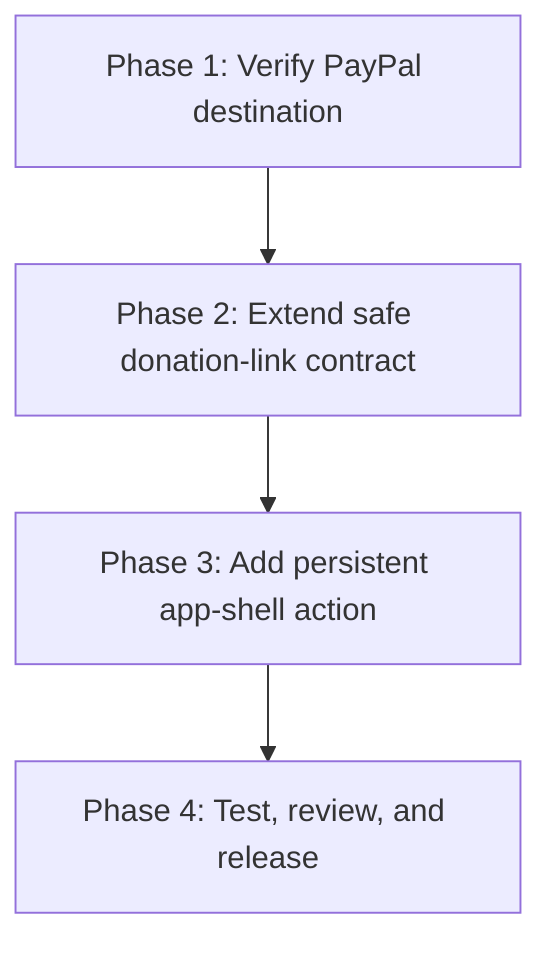

# droid.or — PayPal Donation Button Feature Plan

**Document Version:** 1.0.0
**Current Date:** November 13, 2026
**Feature Status:** Implemented — persistent app-shell action; release browser smoke test pending
**Target Surface:** Persistent application header (`AppShell.vue`)
**Guiding Engineering Skills:** [Ponytail](../.agents/skills/ponytail/SKILL.md) (smallest complete change) & [Impeccable](../.agents/skills/impeccable/SKILL.md) (Operate-mode UI craft, accessibility, and hierarchy)

---

## 1. Feature Objective & Product Boundaries

Add a quiet **Donate with PayPal** action to the persistent application header
so it remains available across every route, not only the Overview. Activating
it opens the project's official, PayPal-hosted donation destination in the
system browser. The app does not collect payment details or process a donation.

Extend the existing donation-link flow rather than introducing a second payment
integration. Keep GitHub Sponsors available through the same persistent
app-shell header. The initial PayPal scope is a voluntary one-time contribution;
recurring donations are not part of this feature.

### Goals

- Keep the PayPal contribution action available on every route.
- Keep the action optional and visually subordinate to device-management tasks.
- Open the verified PayPal destination in the user's system browser.
- Reuse the existing support IPC, result handling, and safe-link validation.
- Keep the action independent of device selection and connection state.
- Avoid collecting, storing, or transmitting payment or donor data through
  droid.or.

### Out of Scope

- Embedded PayPal checkout, the PayPal JavaScript SDK, or payment processing
  inside Electron.
- A new payment backend, database, analytics, donation history, or telemetry.
- Recurring donations or donation amounts configured inside droid.or.
- Changes to the About modal or GitHub Sponsors integration.
- Claims that contributions are tax-deductible or unlock product features.

### PayPal Destination Prerequisite

The maintainer supplied and confirmed the intended one-time donation destination:
`https://paypal.me/ORenteriaQuevedo`. The app stores this public URL as a
constant and permits only the exact `paypal.me` hostname over HTTPS. No PayPal
credentials, client secrets, or payment tokens are used.

---

## 2. Phased Implementation Roadmap



---

## 3. Phase 1: Verify the PayPal Destination

**Objective:** Verify the recipient-controlled PayPal donation destination
before enabling the provider.

### Task Status Board

| Status | Task ID | Description | Target Files | Verification Command |
| :---: | :--- | :--- | :--- | :--- |
| `[COMPLETED]` | **PAYPAL-01** | Obtain and verify the official one-time PayPal donation URL | Maintainer-confirmed `https://paypal.me/ORenteriaQuevedo` | Maintainer confirmed intended recipient and one-time contribution |

### PAYPAL-01 — Verify and Configure the Donation Destination

**Dependency:** Maintainer access to the project's PayPal donation settings.

- The maintainer supplied `paypal.me/ORenteriaQuevedo` and confirmed the
  intended recipient and one-time contribution.
- Normalize the URL to HTTPS and configure it as the canonical
  `PAYPAL_DONATION_URL`.
- Keep the destination static and owned by the application; do not accept
  arbitrary destination URLs from renderer input.

**Done when:** The maintainer-confirmed URL is stored as the application
constant and only the exact required host is allowlisted.

---

## 4. Phase 2: Secure Donation-Link Contract

**Objective:** Extend the existing main-process allowlist and shared provider
contract without exposing arbitrary URL opening.

### Task Status Board

| Status | Task ID | Description | Target Files | Verification Command |
| :---: | :--- | :--- | :--- | :--- |
| `[COMPLETED]` | **PAYPAL-02** | Add PayPal to the validated provider contract and exact-host allowlist | `src/shared/constants/support.ts`, `src/shared/validation/support.schema.ts`, `src/main/support/support-config.ts`, support IPC tests | `npx vitest run tests/shared/support.schema.test.ts tests/main/support/support-config.test.ts tests/main/ipc/support.handler.test.ts` |

### PAYPAL-02 — Extend the Existing Secure Donation-Link Contract

**Depends on:** PAYPAL-01.

- Add `'paypal'` to `DonationProviderId` in the shared support schema.
- Map `'paypal'` to `PAYPAL_DONATION_URL` in the main-process donation
  configuration.
- Extend `validateSafeExternalUrl` to accept only the verified PayPal hostname
  (and any explicitly verified additional hostname). Require HTTPS and reject
  lookalikes, arbitrary subdomains, non-HTTPS URLs, and malformed URLs.
- Keep the existing `openDonationLink` IPC channel and schema-validated
  provider payload. Do not add an IPC channel or expose `shell.openExternal`
  to the renderer.
- Preserve existing success, launch-error, and invalid-provider behavior.

**Done when:** The main process can open the configured PayPal destination and
cannot be made to open an arbitrary URL by renderer input.

---

## 5. Phase 3: Persistent App-Shell Action & Interaction

**Objective:** Make the optional PayPal path available across every route by
placing a restrained action in the persistent application header.

### Task Status Board

| Status | Task ID | Description | Target Files | Verification Command |
| :---: | :--- | :--- | :--- | :--- |
| `[COMPLETED]` | **PAYPAL-03** | Add the accessible PayPal action to the persistent application header using the existing support-link composable | `src/renderer/src/components/layout/AppShell.vue`, existing support-link composable | `npx vitest run tests/renderer/composables/useSupportLink.test.ts`; check visibility across app routes |

### Placement & Visual Treatment

- Place **Donate with PayPal** in the persistent application header beside the
  existing Logs and Settings actions. This makes it available on every route
  and independent of whether a device is selected or connected.
- Keep the action visually quiet and secondary to the product name, device
  status, and route-specific tasks. Do not place it among device operations or
  destructive controls.
- Use the existing Naive UI button and project theme, sizing, spacing, and
  visible keyboard-focus treatment. Give it a subtle primary-tinted secondary
  treatment so its button shape and hover state are easy to recognize beside
  the quaternary utility actions; keep its label contrast-safe, optional, and
  free of urgency cues.
- Use clear text, not color or a logo alone, to identify PayPal. Do not add a
  new icon/asset dependency just for this action.
- Keep the action reachable at the minimum supported window width without
  causing header overflow or displacing device status and Settings.

### PAYPAL-03 — Implement the Persistent App-Shell Action

**Depends on:** PAYPAL-02.

- Add the action to `AppShell.vue` and invoke
  `useSupportLink().openSupportLink('paypal')`.
- Keep it in the application header so it persists while navigating between
  Overview, Apps, Install, Settings, Logs, and other routes.
- Reuse the composable's duplicate-click guard, loading state, and
  notifications.
- Keep the action keyboard-operable, with a visible focus indicator and
  accessible name containing “PayPal”. Do not depend on a PayPal logo for its
  label.

**Done when:** The action remains visible across application routes, opens
PayPal using the existing support flow, and does not alter route behavior.

---

## 6. Phase 4: Verification, UI Review & Release

**Objective:** Verify contract and renderer behavior, review the persistent
header at supported sizes and themes and across routes, and confirm the external
destination without submitting a payment.

### Task Status Board

| Status | Task ID | Description | Target Files | Verification Command |
| :---: | :--- | :--- | :--- | :--- |
| `[COMPLETED]` | **PAYPAL-04** | Test provider validation, launch outcomes, persistent route visibility, and accessibility | Support tests; support-link tests; `src/renderer/src/components/layout/AppShell.vue` | 4 focused test files / 26 tests; typecheck/build; visual and keyboard review |

### PAYPAL-04 — Test and Verify

**Depends on:** PAYPAL-01, PAYPAL-02, and PAYPAL-03.

- Extend support schema tests to accept `'paypal'` and reject unknown
  providers.
- Extend support configuration tests to cover the configured PayPal URL and
  strict hostname/HTTPS validation, including a lookalike hostname.
- Extend support handler tests for a valid PayPal request, invalid provider,
  invalid configured URL, successful browser launch, and browser-launch
  failure.
- Extend `useSupportLink` tests for the `'paypal'` provider, loading guard, and
  existing failure feedback.
- Run focused tests and typecheck, then inspect the global header on Overview,
  Settings, and a device view at normal and narrow widths in light and dark
  themes. Verify keyboard-only access and focus visibility.
- In a release candidate, activate the button and verify the external browser
  reaches the expected PayPal recipient and donation flow. Stop before
  submitting a real payment unless the maintainer explicitly authorizes a
  test donation.

**Done when:** Focused tests, typecheck, responsive/theme review, and
destination verification pass; no payment is submitted as part of routine
testing. The separate release browser smoke test remains open until the
maintainer chooses to open the destination in a system browser.

Suggested automated checks:

```sh
npx vitest run \
  tests/shared/support.schema.test.ts \
  tests/main/support/support-config.test.ts \
  tests/main/ipc/support.handler.test.ts \
  tests/renderer/composables/useSupportLink.test.ts
npm run typecheck
```

### Release Checklist

- [x] Production PayPal donation URL supplied and verified by the maintainer.
- [x] Exact HTTPS destination hostname allowlisted; no broad wildcard domains.
- [x] PayPal recipient and intended one-time donation behavior confirmed.
- [x] App-shell action remains visible independent of route and device state.
- [x] Keyboard focus, accessible name, light/dark theme, and narrow-width
      layout verified.
- [x] Failure to launch the external browser is reported without success-shaped
      feedback.
- [x] No payment details, secrets, donor data, or donation events are stored or
      sent by droid.or.
- [ ] Release smoke test opens the intended PayPal page without submitting a
      payment.

---

## 7. Implementation Touchpoints

- `src/shared/constants/support.ts` — canonical PayPal donation URL.
- `src/shared/validation/support.schema.ts` — provider ID.
- `src/main/support/support-config.ts` — provider mapping and exact-host
  allowlist validation.
- `src/main/ipc/handlers/support.handler.ts` — existing validated external-open
  flow; extend only if tests reveal a necessary change.
- `src/renderer/src/components/layout/AppShell.vue` — persistent action and
  placement beside global navigation controls.
- `src/renderer/src/composables/useSupportLink.ts` — reuse; avoid a second
  launcher implementation.
- `tests/shared/support.schema.test.ts`,
  `tests/main/support/support-config.test.ts`,
  `tests/main/ipc/support.handler.test.ts`,
  `tests/renderer/composables/useSupportLink.test.ts` — extend existing
  coverage or add the smallest missing focused test.

The preload bridge and `DroidorApi` already accept the shared
`DonationProviderId`; they should not need a new method or IPC channel.

### Interaction & Feedback

1. The user activates **Donate with PayPal**.
2. The renderer requests the `paypal` provider through the existing
   `openDonationLink` bridge.
3. The main process validates the provider and configured HTTPS URL, then asks
   Electron to open it in the system browser.
4. Reuse the existing support-link loading guard and success/failure feedback.
   Do not add an in-app payment dialog, webview, or donation confirmation
   screen.
5. If the browser cannot be opened, preserve the current support-link fallback
   behavior and communicate the failure clearly; do not report success.

The user must see the actual PayPal page before making a payment. droid.or must
not imply that clicking the button itself completes a donation.
